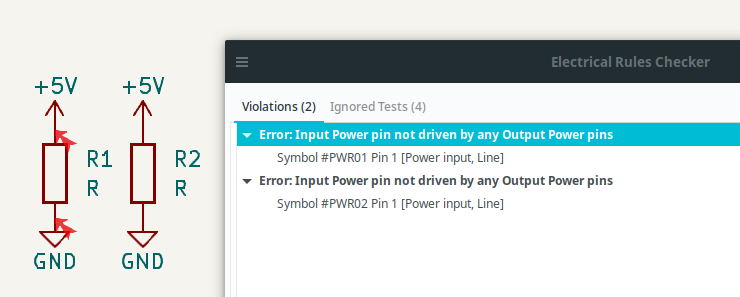

# 第 3 章：让原理图可检查——ERC、层次图与设计意图

> **开门一句话：**ERC 按你写下的电气规则检查这张图；它替你重复检查，但不理解电路功能。

## 学习目标

读完这章，你能做到：

- 跑一次 ERC，按“错误—警告—排除”处理报告，并识别外部供电网络何时需要 `PWR_FLAG`；
- 说清层次标签、全局标签、局部标签的边界；
- （选学扩展）用层次图与总线拆分复杂图纸，并用设计变体、跳线和局部电源符号表达可选装配方式。

**难度定位：**起步段的后半。ERC 会暴露前两章埋下的问题，建议先备份 `v0.1`。

> **必做 / 选做：**3.1 与 3.6 节（ERC 与处理循环）是基线必做；3.2 层次图、3.3 总线、3.5 变体/跳线/局部电源都是**可选扩展**。基线工程 `usb_breath_led` 只有一张原理图，不需要拆子页、画总线或建变体；下面相关练习标为“选做”，可在完成第 4 章同步到 PCB 之后再回来做。

---

## 3.1 ERC 到底检查什么

ERC（Electrical Rules Check）在原理图上逐条检查电气规则。它不等同于“电路一定正确”，但能抓住大量低级错误：

| 检查类别 | 典型问题 | 后果 |
| --- | --- | --- |
| 引脚冲突 | 两个输出接在一起 | 电气争用，可能烧器件 |
| 未连接 | 输入引脚悬空 | 电平不确定，误触发 |
| 电源引脚 | 电源输入没有驱动 | 芯片不上电 |
| 标签冲突 | 同名标签类型不一致 | 网络合并错误 |
| 层次引脚 | 子页引脚与内部网络不匹配 | 连接断开 |
| 总线 | 总线成员未展开 | 信号缺失 |

在原理图编辑器里，ERC 通常位于 `Inspect → Electrical Rules Checker`。点击 `Run ERC`，报告会按严重程度分组。每一项都带：

- 违规类型（例如 `Pin not connected`）；
- 具体对象（`U1 pin 3`）；
- 位置坐标；
- 一个可以跳转到图面的链接。

### 先看“错误”，再看“警告”

错误通常意味着“电气上不成立”，必须处理；警告可能是“设计意图不明确”，需要你判断。下面三条都是默认 Error 的连接类报错，但处理方式不同：

- `Input pin not driven by any Output pins`：先看它是否真的悬空。信号若来自外部连接器，连接器的无源（passive）引脚在 ERC 里已经算作驱动者，通常不会触发这一条；若信号确实由板外的编程器/测试夹具临时提供，在图上写注释说明，而**不要**给该引脚放“未连接”标志——那会把真实连接伪装成有意不接，KiCad 会另报 `A pin with a "no connection" flag is connected`。
- `Input Power pin not driven by any Output Power pins`：通常是真的漏了电源；
- `Label not connected`：标签贴在了空处，或者拼写与别处不一致。

> **常见卡点（供电入口）：**USB-C 与保险丝的引脚属于无源类；若 LDO 的 Power input 没连到 Power output，ERC 会报 `Input Power pin not driven by any Output Power pins`。在本项目中，按报告把 `PWR_FLAG`（位于 `power` 库、引脚类型为 Power output）放到未驱动的 `+5V` 网络；`GND` 若所用符号的地脚也是 Power input、且报告同样指出未驱动，也要在 GND 网络单独标记。`+3V3` 由 LDO 的 Power output 驱动时通常不需要旗标。旗标只告诉 ERC 外部电源存在，不是供电器件，也不能代替真实连线；加完后复跑 ERC 并检查原理图。

> **提示：**不要一上来就点“全部排除”。排除项会留在工程里，下一个人看不到你当时的理由。每排除一条，至少在图面加一句注释，说明“为什么可以忽略”。

## 3.2 从一张图到一个层次

当原理图超过两页，继续平铺会变得难以维护：电源在一角，MCU 在另一角，接口在第三角，网络标签满天飞。层次图（Hierarchical Schematic）把电路拆成“根图 + 子页”，每个子页只暴露少量层次引脚。

```ill
kicad-ch03-hierarchy
```

图 3-1 根图与三个子页。子页之间的连接通过层次引脚和层次标签完成，而不是把所有线拉到根图。

### 建一个子页

1. 在根图按 `S`（Add Hierarchical Sheet），拖出一个矩形；
2. 双击子页，给它命名（例如 `power`），并选择“新建文件”；
3. 在子页里画电路，用 `Hierarchical Label`（`H`）放置对外标签；
4. 回到根图，选中子页后从右键菜单选 `Sync Sheet Pins`，或用 `Place → Sync Sheet Pins`（右侧工具栏同名按钮），把子页里的层次标签同步成子页边框上的层次引脚；需要统一摆放时可用 `Autoplace All Sheet Pins`。层次引脚**不会**在放标签时自动出现在根图，这一步必须手动执行；
5. 用导线或标签把根图的网络接到这些引脚上。

> **前提 / 预期观察 / 失败路径：**先保存子页并给层次标签命名；同步后，根图的子页边框应出现与标签同名的引脚。若 ERC 报 `Mismatch between hierarchical labels and sheet pins`，说明标签与引脚不同步，重新执行 `Sync Sheet Pins`；不要直接删掉标签，那会让子页信号失去对外连接。

### 三种标签的边界

| 标签类型 | 作用范围 | 典型用途 |
| --- | --- | --- |
| 局部标签 | 当前图纸 | 页内短连接 |
| 层次标签 | 子页与父页之间 | 子页的输入/输出 |
| 全局标签 | 整个工程 | 电源、复位、调试口 |

电源符号是全局标签的一种特例。KiCad 10 的“局部电源符号”可以把某个电源限制在当前图纸，适合“每个子页各自稳压”的设计。

> **警惕：**在子页里放一个普通的 `+3V3` 电源符号，它会和根图的 `+3V3` 全局相连。如果子页其实有独立的稳压器，这就制造了一个隐蔽的电源合并。用局部电源符号，或改用不同网络名。

## 3.3 总线：把一组信号画成一根粗线

总线（Bus）表示“一组同名网络的可视化集合”，并不传递多个模拟信号。例如：

```text
D[0..7]
```

表示 `D0` 到 `D7` 八根网络。画总线时，用总线入口（Bus Entry）把单根线斜接到总线上，并给单根线标上 `D0`、`D1` 等名字。ERC 会检查总线成员是否完整。

总线适合地址线、数据线、并行接口。它不会减少 PCB 上的铜线数量，只减少原理图的视觉噪声。

## 3.4 用“未连接”标志表达真实意图

有些引脚本来就不接。例如：

- 未使用的 GPIO；
- 预留的测试点；
- 只在一个变体里装配的连接器。

对这些引脚，放一个 `No Connect` 标志（通常是 `Q` 或工具栏上的叉号）。它用来明确标记**这里是有意不接，不是漏画**，让 ERC 和读图的人都看到这个意图。

没有标志的悬空引脚，ERC 会报“未连接”；放了标志，报告消失，但设计意图被记录在图上。两者差别很大。

## 3.5 变体、跳线与局部电源：KiCad 10 的新表达

KiCad 10 增加了几个直接服务“设计意图”的功能：

### 设计变体（Design Variants）

变体让同一个工程产生不同的装配版本。例如：

- `standard`：全部器件装配；
- `lite`：去掉 LED 和按键，只保留 MCU 与电源；
- `debug`：加上测试排针，去掉外壳相关的连接器。

变体在同一张原理图/PCB 上标记“这个器件在某个变体里装不装、用什么值”，不需要复制工程。BOM 和贴片文件可以按变体输出。

### 跳线（Jumper）

跳线把符号引脚和封装焊盘标记为“器件内部已连通”。在原理图上，它们仍然显示为不同引脚；在 PCB 上，它们属于同一个网络，不会产生飞线。适合：

- 0 Ω 电阻短接；
- 连接器内部的短接片；
- 封装内部已经连在一起的多个焊盘。

### 局部电源符号

前面已经提到：局部电源符号只在当前图纸内连接，不跨页。它解决的是“多个子页各有自己的电源域”这个老问题。

> **版本差异：**设计变体、跳线和局部电源符号都是 KiCad 10 新增的能力（官方 10.0.0 发布说明 “Version 10 Changes → Schematic Editing”）；用 KiCad 9 及更早版本时，需要用“多工程”“0 Ω 电阻”“不同网络名”等替代做法。

## 3.6 ERC 的处理循环：报告—定位—修正—复跑

把 ERC 当成一个循环，而不是一次性的按钮：

```ill
kicad-ch03-erc-loop
```

图 3-2 ERC 处理循环。每次修正后复跑，直到报告只剩“已解释的排除项”。

<figure class="illu illu-photo screenshot">
<div class="illu-frame"></div>
<figcaption><span class="fig-no">图 3-3</span><span class="fig-cap">ERC 报告与原理图标记的对应。选中报告中的违规，原理图上的对象会被指出；先定位对象，再核对规则和严重级别，不要只看报告文字猜位置。</span></figcaption>
</figure>

一个可操作的顺序：

1. **先跑一遍，不修改**：把报告导出为文本，作为基线；
2. **按类型分组**：先处理电源和未连接，再处理标签冲突；
3. **一次只改一类**：改完复跑，确认没有引入新问题；
4. **记录排除理由**：在原理图注释或工程 README 里写清楚；
5. **把 ERC 放进提交前检查**：第 15 章会用 `kicad-cli sch erc` 把它自动化。

命令行版本：

```bash
kicad-cli sch erc usb_breath_led.kicad_sch \
  --output erc.rpt \
  --severity-all \
  --exit-code-violations
```

`--exit-code-violations` 让命令在存在违规时返回非零退出码，CI 才能据此阻断。报告格式和选项可以用 `kicad-cli sch erc --help` 查看当前版本支持的完整列表。

## 3.7 图纸模板与标题栏

原理图右下角的标题栏记录这些信息：

- 工程名、版本、日期；
- 作者/团队；
- 图纸编号与总页数；
- 修订记录。

团队应使用统一的 `.kicad_wks` 图纸模板，把公司名、项目代号、保密级别放进去。模板文件进版本库，新工程从模板复制，而不是每次手填。

标题栏里的版本号要与 Git 标签、BOM 版本、Gerber 文件名对得上。第 10 章会把这条规则延伸成“制造文件命名规范”。

## 本章小结

- ERC 检查的是电气规则，不是电路功能；它能抓低级错误，但不能替代设计评审。
- （选学扩展）层次图用子页和层次引脚拆分复杂度；总线与变体能表达更大的连接/装配方案，但不是本项目单页基线的验收条件。
- “未连接”标志只表达有意不接；KiCad 10 的变体、跳线、局部电源符号是可选扩展。
- ERC 要按“报告—定位—修正—复跑”循环处理，并把排除理由写下来。
- 外部电源经连接器、保险丝或滤波器进入时，按 ERC 报告在未驱动的 `+5V`、`GND` 等网络放 `PWR_FLAG`；旗标不替代电源或导线。

## 练习

1. 在基线单页图上运行 ERC；若 `+5V` 或 GND 报电源输入未驱动，按报告放 `PWR_FLAG` 并复跑，确认供电连线仍然存在。
2. 故意制造一个“两个输出接在一起”的错误，观察 ERC 的措辞；修正后复跑。
3. （选做扩展）把第 2 章的 `usb_breath_led` 拆成 `power`、`mcu`、`io` 三个子页，根图只保留层次引脚和电源连接。
4. （选做扩展）建一个 `lite` 变体，去掉 LED 和按键，导出 BOM，比较两个变体的差异。

## 验收

- ERC 报告中每一条剩余项都有书面理由；
- 基线中的未驱动电源输入均按实际 ERC 报告处理；没有用 `No Connect` 标志掩盖供电网络。
- （选做扩展）子页的每个层次引脚都能在父页找到对应连接；
- （选做扩展）变体切换后，BOM 的装配数量正确变化；
- 图纸标题栏的版本号与 Git 提交一致。

下一章把符号落到封装：你会第一次遇到“引脚编号对不上焊盘”的问题，也会理解为什么 BOM 要在设计时维护，不能等到导出才想。
