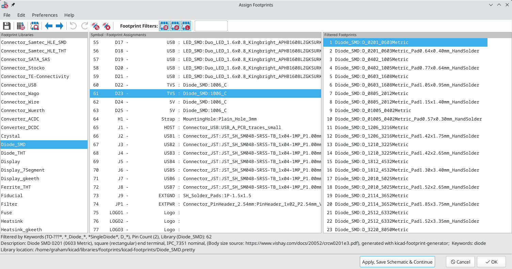

# 第 4 章：从符号到封装——库、封装分配与 BOM

> **开门一句话：**符号决定“电气上是谁”，封装决定“物理上长什么样”；两者对不上，板子就无法按图工作。

## 学习目标

读完这章，你能做到：

- 看懂 KiCad 的全局库表与工程库表，知道库从哪里来；
- 给每个符号分配正确的封装，并检查引脚编号与焊盘编号；
- 维护 Reference、Value、Footprint、MPN、Manufacturer 等字段；
- 导出结构正确的 BOM，并解释每一列的去向。
- 将原理图中的符号与封装正向同步到 PCB，并检查更新清单中的增删项。

**难度定位：**起步段收尾。本章完成后，原理图才具备“转到 PCB”的条件。

---

## 4.1 库与库表

KiCad 的库分两类：

- **符号库**（`.kicad_sym`）：原理图符号；
- **封装库**（`.kicad_mod` 的集合，通常是 `.pretty` 目录）：PCB 焊盘图形。

每类库都通过一张“库表”注册到工程：

| 库表 | 位置 | 作用 |
| --- | --- | --- |
| `sym-lib-table` | 工程根目录 | 本工程可用的符号库 |
| `fp-lib-table` | 工程根目录 | 本工程可用的封装库 |
| 全局库表 | KiCad 配置目录 | 所有工程共享的库 |

工程库表优先于全局库表。团队协作时，把项目专用库放在工程目录里，并在 `sym-lib-table` / `fp-lib-table` 中使用相对路径（`${KIPRJMOD}/lib/...`），这样换电脑不会断链。

> **提示：**不要把库放在工程目录之外再用绝对路径引用。只要换一台机器，路径就会失效，原理图会显示“符号缺失”，PCB 会显示“封装缺失”。

## 4.2 封装命名的读法

KiCad 官方封装名通常遵循“系列:形状_尺寸_间距”的结构，例如：

```text
Package_SO:SOIC-8_3.9x4.9mm_P1.27mm
```

拆开看：

- `Package_SO`：封装库名；
- `SOIC-8`：封装类型与引脚数；
- `3.9x4.9mm`：本体尺寸；
- `P1.27mm`：引脚间距。

看到这个名字，你至少能核对三件事：引脚数对不对、本体尺寸能不能放进外壳、间距能不能手焊。封装名首先是给你自己防错用的。

### 引脚编号是唯一契约

原理图符号的每个 pin 有一个 **number**；封装的每个 pad 也有一个 **number**。KiCad 通过编号把两者连起来，而不是通过引脚名。

```ill
kicad-ch04-symbol-footprint
```

图 4-1 符号引脚与封装焊盘的编号对应。名字可以不同，编号必须一致。

常见错误：

- 符号按“功能”编号（1= VCC、2= GND），封装按“物理顺序”编号（1=左上、2=左下），结果电源接到信号脚；
- 二极管、LED、电解电容的阳极/阴极编号与封装相反；
- 三极管的 B/C/E 与封装 SOT-23 的 1/2/3 对应错位；
- 连接器的 pin 1 方向与实物相反。

这些错误 ERC 不一定能发现，但上电就会暴露。分配封装后，务必对照数据手册的 pinout 图逐脚核对，尤其是非对称器件。

把封装放进工程前，先做一张核对卡：方向、编号、尺寸、边界，逐项打勾，而不是只看封装名。

```ill
kicad-ch04-footprint-audit
```

图 4-2 封装核对卡。顶视图从右上 pin 1 起逆时针核对 1→8 与焊盘编号，侧视图看本体、引脚和 courtyard；名字相同不代表封装可以互换。


*图 4-3：SOP 器件焊接在 PCB 上的实物。器件本体、引脚和焊盘编号要分开核对；示例为 14 pin 器件，不是本书 ATtiny85 的封装尺寸图。*

## 4.3 分配封装的三种入口

### 从符号属性里改

双击符号，打开属性对话框，在 `Footprint` 字段里选择库和封装。适合单个修改。

### 用“Assign Footprints”批量分配

`Tools → Assign Footprints` 会列出原理图中所有符号及其当前封装。你可以按库筛选、按名称搜索、批量应用。适合第一次给整张图分配。

<figure class="illu illu-photo screenshot">
<div class="illu-frame"></div>
<figcaption><span class="fig-no">图 4-4</span><span class="fig-cap">CvPcb 的 Assign Footprints 窗口。左侧按封装库筛选，中间列出符号与当前封装，右侧是候选封装；先缩小范围，再逐个确认，不要只看名字相似。</span></figcaption>
</figure>

### 从符号库浏览器添加

按 `A` 打开“添加符号”对话框并选中符号时，若该符号定义了默认封装，预览区会直接显示它，添加后该封装自动填入 Footprint 字段；没有默认封装时下拉框显示 `No default footprint`。也可以打开符号库浏览器（符号编辑器 `View → Symbol Library Browser`，原理图编辑器 `Tools → Symbol Library Browser`），**双击符号名**或点“Add symbol to schematic”按钮把符号加入原理图；官方文档没有“从库浏览器拖放到图纸”的操作。

> **前提 / 预期观察 / 失败路径：**封装库在首次打开封装编辑器或封装库浏览器时才加载；在此之前，添加符号对话框的封装下拉框可能是空的。若显示 `No default footprint`，通常表示符号没有默认封装，并非符号损坏；请按本节其他入口手动分配。

> **警惕：**默认封装不一定适合你的装配方式。一个 SOIC-8 符号可能默认关联到“窄体”封装，而你买到的是“宽体”；一个 USB-C 符号可能默认关联到 16 pin 母座，而你用的是 24 pin 双排。默认值仍需逐项核对。

## 4.4 字段：让 BOM 能采购、能追溯

一个符号除了 Reference、Value、Footprint，还应该维护这些字段：

| 字段 | 示例 | 用途 |
| --- | --- | --- |
| `MPN` | `ATTINY85-20SU` | 制造商料号，采购与替代 |
| `Manufacturer` | `Microchip` | 品牌 |
| `Description` | `AVR MCU, 8KB Flash, SOIC-8` | 可读描述 |
| `Supplier` | `LCSC` / `Digi-Key` | 采购渠道 |
| `Supplier Part` | `C1234` | 渠道料号 |
| `DNP` | `1` / `0` | 是否不装配 |
| `Notes` | `仅 debug 变体装配` | 变体/装配说明 |

字段够用即可，至少要保证：**采购能凭 MPN 买到，贴片能凭 Reference 找到位置，维修能凭 Description 知道这是什么**。

```ill
kicad-ch04-bom
```

图 4-5 符号字段导出为 BOM。BOM 是设计时字段的投影，不能等到导出才维护。

## 4.5 BOM 的结构：一行代表什么

KiCad 的 BOM 导出可以按值、封装等字段分组，把相同器件合并成一行，并列出所有参考号。预设和工厂模板不一定一致；导出前先确认 `--group-by` 或界面中的分组字段。一个典型的 BOM 列：

| 列 | 含义 | 常见错误 |
| --- | --- | --- |
| `Reference` | 参考号列表，如 `R1,R2,R3` | 同一行混入不同值 |
| `Value` | 值，如 `10k` | 写成“电阻” |
| `Footprint` | 封装名 | 与实物不符 |
| `QUANTITY` | 数量 | 与参考号数量不一致 |
| `MPN` | 制造商料号 | 空值导致无法采购 |
| `DNP` | 不装配标记 | 变体切换后忘记更新 |

导出命令：

```bash
kicad-cli sch export bom usb_breath_led.kicad_sch \
  --output bom.csv \
  --fields "Reference,Value,Footprint,QUANTITY,MPN,Manufacturer,DNP" \
  --labels "Refs,Value,Footprint,Qty,MPN,Manufacturer,DNP"
```

不同版本的 `--fields` 支持可能不同，先用 `kicad-cli sch export bom --help` 确认。若使用旧式 BOM 脚本，命令是 `kicad-cli sch export python-bom`，输出 XML 供脚本处理；新设计优先用内置 CSV。

### BOM 的三个读者

同一张 BOM 会被三类人读：

1. **采购**：看 MPN、数量、替代料；
2. **贴片厂**：看 Reference、Footprint、位号；
3. **维修/测试**：看 Description、Notes、变体。

所以 BOM 不能只“能导出”，还要“每一列都有明确读者”。没有读者的列，删掉；有读者的列，不能空。

## 4.6 封装与装配方式：先决定怎么焊，再决定用什么封装

同一个器件可以有多种封装，选择取决于装配方式：

| 封装 | 适合 | 风险 |
| --- | --- | --- |
| DIP / THT | 手焊、面包板、教学 | 体积大，孔多 |
| SOIC / SOP | 手焊（0.65–1.27 mm 间距） | 间距小，需要助焊剂 |
| QFN / DFN | 回流焊、热风 | 中心焊盘难手焊，需钢网 |
| BGA | 工厂回流 | 手焊几乎不可能，需 X-ray |
| 模块（ castellated） | 手焊/回流 | 模块本身的引脚定义要核对 |

教学板建议“SOIC + 0805 + 2.54 mm 排针”的组合：既能手焊，又能练到贴片的基本功。第一版不要上 0402 或 QFN，除非你已经有热风台和钢网。

> **提示：**封装选择要在画原理图时就定，不要等 PCB 布局时再换。换封装会改变焊盘编号、占位、布线难度，越晚改成本越高。

## 4.7 库的版本与团队协作

官方库随 KiCad 版本更新。团队必须约定：

- 使用哪个 KiCad 主版本；
- 使用官方库的哪个版本/分支；
- 项目专用库放在哪里；
- 谁有权修改库，修改后如何评审。

最小做法：

```text
usb_breath_led/
├── lib/
│   ├── symbols/
│   │   └── usb_breath_led.kicad_sym
│   └── footprints/
│       └── usb_breath_led.pretty/
├── sym-lib-table
└── fp-lib-table
```

库表里写：

```text
(sym_lib_table
  (version 7)
  (lib (name "usb_breath_led")(type "KiCad")
       (uri "${KIPRJMOD}/lib/symbols/usb_breath_led.kicad_sym")(options "")(descr "项目专用符号"))
)
```

封装库表同理。把库和工程一起提交，别人克隆下来就能打开，不会出现“符号缺失”。

## 4.8 将原理图正向标注到 PCB

封装分配完成后，不要在 PCB 里逐个手工重建器件。使用 `Update PCB from Schematic` 把符号、封装和网络同步到板文件；这就是正向标注（forward annotation），不需要另存或导入中间网表。

1. 保存原理图；若仍有 `R?`、`U?`，用顶部工具栏的 `Annotate` 工具分配唯一参考号；确认要上板的符号已有 Footprint。
2. 在原理图编辑器选择 `Tools → Update PCB from Schematic`；默认快捷键是 `F8`。
3. 检查 `Changes To Be Applied` 清单，核对将新增、替换或删除的封装，再点 `Update PCB` 应用。点击前，板文件不会被修改。
4. 点击 `Close` 关闭更新清单，再在 PCB 画布单击一次，将新增封装放下；它们暂时保留导入时的相对位置，后续再布局。
5. 保存 PCB，核对参考号与飞线。后续原理图改动时，重复 F8、审查清单后再应用；布局与布线见第 6、7 章。

几个边界要分清：

- 标记为 `Exclude from board` 的符号不会同步到 PCB；`DNP` 表示不装配，不等于从 PCB 排除。
- 若原理图改了 Footprint，检查 `Replace footprints with those specified by symbols`；未启用时，已有 PCB 封装可能不会替换。
- `Delete footprints with no symbols` 可能删除没有对应原理图符号的板上封装；审查清单再应用。
- `Re-link footprints to schematic symbols based on their reference designators` 通常保持关闭；只有符号被删除后重新创建、UUID 链接丢失时才按位号重连。

## 本章小结

- 符号/封装库以库表注册；项目库入版本控制并用相对路径。
- 封装名包含引脚数、尺寸、间距；分配后必须核对 pin number 与 pad number。
- BOM 是设计字段的导出结果；字段要在设计时维护，每列都要有明确读者。
- 封装选型要适配装配方式；分配完成后用 F8 将封装和网络同步到 PCB。

## 练习

1. 给 `usb_breath_led` 的每个符号分配封装，列出一张“符号—封装—引脚数”核对表。
2. 故意把 LED 的阳极/阴极封装选反，观察 PCB 上焊盘与丝印的关系，再改回。
3. 导出 BOM，检查是否有空 MPN、空 Footprint、参考号重复。
4. 按 F8 将原理图同步到 PCB，核对更新清单、封装位号和飞线网络；故意改变一个符号的 Footprint，观察更新选项如何影响现有封装。

## 验收

- 每个符号都有封装，且引脚数与焊盘数一致；
- BOM 中每一行的 Reference 数量与数量列一致；
- 工程库表使用相对路径，换目录后仍能打开；
- 你能说出每个封装为什么适合当前装配方式。
- 首次同步后，PCB 中的封装与网络对应原理图；有意排除的符号没有上板。

下一章进入 PCB：先定板框、层叠和规则，再把图变成板。
