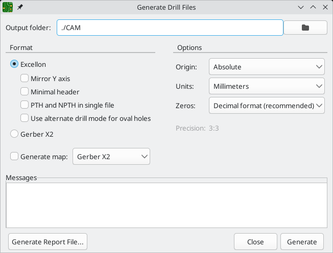

# 第 10 章：输出制造文件——Gerber、钻孔与贴片文件

> **开门一句话：**工厂不会打开你的 KiCad 工程；它只读你导出的文件。文件少一层、错一位，板子就多一次返工。

## 学习目标

读完这章，你能做到：

- 说清 Gerber、钻孔、贴片坐标、BOM、IPC-2581/ODB++ 各自的作用；
- 用 `kicad-cli` 一条命令导出一整套制造文件；
- 检查层对齐、钻孔与焊盘、阻焊开窗、板框；
- 用 `.kicad_jobset` 把输出流程固化，保证每次构建一致。

**难度定位：**制造篇开始。本章的命令可以直接复制使用。

---

## 10.1 制造文件包含什么

先把“必须交付”和“按需交付”分开。本项目用 `kicad-cli` 就能离线产出核心文件，不依赖任何第三方插件；表里标“可选”的文件只在工厂或工艺明确要求时才生成，多生成反而增加误读风险。

| 文件 | 内容 | 工厂用它做什么 | 本项目 |
| --- | --- | --- | --- |
| Gerber（每层一个） | 铜、阻焊、丝印、板框 | 光绘/曝光/蚀刻/丝印 | 必需 |
| 钻孔文件（Excellon） | 孔位、孔径、镀通/非镀通 | 钻孔 | 必需 |
| 贴片坐标（CPL/POS） | 位号、X/Y、旋转、层 | 贴片机编程 | 必需（委托组装时） |
| BOM | 位号、值、封装、料号、数量 | 采购/备料 | 必需（委托组装时） |
| `fab/README.txt` | 版本与日期、层数、板厚、铜厚、表面处理、单位、原点、特殊工艺、联系人 | 人工核对工艺意图 | 必需 |
| 钻孔图/表 | 孔位示意与孔径统计 | 人工核对 | 可选 |
| 3D（STEP） | 板与器件外形 | 结构干涉检查 | 可选 |
| IPC-2581 / ODB++ | 一体化制造数据 | 部分工厂/高阶工艺 | 可选 |
| 测试文件 | 网表、测试点 | 飞针/治具 | 可选 |

```ill
kicad-ch10-fab-package
```

图 10-1 `fab/` 目录的交付集。标“必需”的构成本项目的最小交付，“可选”的按需加入。图中若同时画出可选文件，表示“可能用到的全集”，不等于每次都要交付。

> **假设场景：**周五下午，你把 `fab.zip` 发给工厂。工程师解压后先把 Gerber 叠起来，再把钻孔图盖上去，最后导入 POS 核对贴装中心。Gerber 与钻孔使用同一个旧原点，孔位仍落在焊盘上；但 POS 来自新一次导出，器件贴装中心因此整体偏离 Gerber 焊盘。三个文件单独看都能打开，叠在一起才发现它们不属于同一次交付。发板前先在这个“验包台”上走一遍，比等板子回来再解释便宜得多。

```ill
kicad-ch10-handoff
```

图 10-2 工厂的验包台。设计端导出 `fab/`，工厂端解压后叠加 Gerber、钻孔与 POS，并抽查孔位、贴装中心和器件方向；图中人物与工具为流程示意，不是实际工厂界面。

## 10.2 Gerber：每一层都要有名字和用途

先在 PCB 编辑器放置并保存 Drill/Place File Origin；选点方法见 10.3。下面的 Gerber 导出使用这个原点：

```bash
kicad-cli pcb export gerbers usb_breath_led.kicad_pcb \
  --output fab/gerbers/ \
  --layers "F.Cu,B.Cu,F.SilkS,B.SilkS,F.Mask,B.Mask,Edge.Cuts" \
  --subtract-soldermask \
  --use-drill-file-origin \
  --no-protel-ext \
  --no-x2
```

常用选项：

- `--layers`：明确列出要导出的层，不要“全导”；
- `--subtract-soldermask`：**删除落在“无阻焊区域”（阻焊开窗）上的丝印**，避免丝印压到裸露的铜/焊盘；它只影响丝印，不改铜层，也不改阻焊层本身；
- `--use-drill-file-origin`：让 Gerber 与钻孔、坐标使用同一个 drill/place 原点（见 10.3）；
- `--no-protel-ext`：输出 `<板名>-<层名>.gbr`，与 10.8 的目录树一致；
- `--no-x2`：关闭 Gerber X2 属性（老设备兼容）；
- `--precision`：坐标精度，默认通常足够。

> **警惕：**`--subtract-soldermask` 的名字容易误读：它不是“从焊盘上减去阻焊开窗”，也不是改铜层。如果你要改的是阻焊开窗大小，那是封装与阻焊设计的问题，不能用这个参数代替。

> **提示：**层名要能自解释。`board-F_Cu.gbr` 比 `board.gbr` 好；工厂每天收到大量文件，命名清楚能减少沟通成本。

### Gerber 自检

- 用 KiCad 自带 Gerber Viewer 打开整套文件；
- 检查顶层/底层是否镜像正确；
- 检查阻焊开窗是否覆盖焊盘；
- 检查板框是否闭合、是否在 `Edge.Cuts`；
- 检查丝印是否压焊盘；
- 检查是否有异常的大铜面/孤立线。


*图 10-3：PCB 实物上的焊盘、丝印与铜面。Gerber 要表达的是这些几何关系；照片不能替代 Gerber Viewer 的逐层叠加检查。*

## 10.3 钻孔：孔位、孔径、镀通

<figure class="illu illu-photo screenshot">
<div class="illu-frame"></div>
<figcaption><span class="fig-no">图 10-4</span><span class="fig-cap">Generate Drill Files 对话框。格式、单位、原点、零抑制和 PTH/NPTH 处理都在这里选择；图中 Origin 仍是 Absolute，本书命令用 --drill-origin plot，操作时切到 Plot&nbsp;/&nbsp;Drill&nbsp;/&nbsp;Place，否则 GUI 与 CI 会产出两套坐标。</span></figcaption>
</figure>

```bash
# 先在 PCB 编辑器里放置原点：Place → Drill/Place File Origin，点在一个已知基准点，然后保存板文件
kicad-cli pcb export drill usb_breath_led.kicad_pcb \
  --output fab/ \
  --format excellon \
  --drill-origin plot \
  --excellon-units mm \
  --generate-map \
  --map-format gerberx2
```

关键点：

- **原点**：本章统一用板上的 **drill/place 原点**（辅助轴原点）。先在 PCB 编辑器里执行 `Place → Drill/Place File Origin`，把它放在明确的基准点（例如板框左上角或某个定位孔中心）并保存板文件。`--drill-origin plot` 使用这个原点；10.2 的 `pcb export gerbers` 和 10.4 的 `pcb export pos` 都用 `--use-drill-file-origin` 指向同一个点。三者原点一致，工厂叠加文件才不会错位。
- **不要混用**：`absolute` 指图纸左上角（page origin），`plot` 指可移动的 drill/place 原点，两者不是一回事。只给钻孔用 `plot`、给坐标用 `absolute`，就会得到两套坐标。
- **单位**：毫米或英寸要写清楚，文件头会标注；
- **镀通/非镀通**：安装孔通常非镀通，过孔镀通；
- **槽孔**：椭圆孔/槽孔要用支持的格式导出，不要用圆孔代替。

检查导出目录和文件头，确认单位、格式与钻头表。KiCad 10 的 [CLI 手册](https://docs.kicad.org/10.0/en/cli/cli.html)说明，`--generate-map` 会额外生成孔位图；它供人核对，不能替代机钻数据。工厂要求把镀通孔（PTH）与非镀通孔（NPTH）分开时，增加 `--excellon-separate-th`，并将实际生成的钻孔文件都列入交付清单。KiCad 10 的 `kicad-cli pcb export drill` 默认合并两类孔；GUI 的 “PTH and NPTH in single file” 是反向开关，默认分开、勾选后才合并。不能只按 GUI 的勾选状态判断 CLI 会生成几个文件。再用 Gerber Viewer 叠加钻孔图与铜层，抽查孔位是否落在焊盘中心。

### 人工核对原点（必须做）

1. 在 PCB 编辑器选择一个可重复定位的孔或基准点，执行 `Place → Drill/Place File Origin` 并保存板文件。
2. 导出钻孔用 `--drill-origin plot`；Gerber 与 POS 都用 `--use-drill-file-origin`。三个文件因此都选用同一 drill/place 原点。
3. 用 Gerber Viewer 叠加钻孔图，选一个已知孔核对是否落在相应焊盘；再按工厂的面别、单位与底层 X 镜像约定检查 POS。**不要只凭原理图/画布的绝对 X/Y 手算来断定文件已对齐。**
4. 在 `fab/README.txt` 记录原点位置、单位、顶/底面与镜像约定，供工厂复核。

> **警惕：**原点、单位或 Y 轴方向只要有一处不一致，整批板都可能错位。上面四步是打包前必须留下记录的检查项，不是“有空再看”。

## 10.4 贴片坐标（CPL/POS）

```bash
kicad-cli pcb export pos usb_breath_led.kicad_pcb \
  --output fab/usb_breath_led-pos.csv \
  --format csv \
  --units mm \
  --use-drill-file-origin \
  --side both
```

列通常包括：

- `Ref`：位号；
- `Val`：值；
- `Package`：封装；
- `PosX`、`PosY`：封装锚点坐标；KiCad 不在导出时计算器件质心；
- `Rot`：旋转；
- `Side`：CSV 原值为小写 `top` / `bottom`。

KiCad 10 的 [CSV 导出实现](https://github.com/KiCad/kicad-source-mirror/blob/10.0/pcbnew/exporters/place_file_exporter.cpp)取封装的 `GetPosition()`，[面别名称](https://github.com/KiCad/kicad-source-mirror/blob/10.0/pcbnew/exporters/place_file_exporter.h)由同一导出器定义。

常见坑：

- 旋转方向：不同工厂对 0° 的定义不同，首件务必核对；
- 原点：本章统一用 drill/place 原点（见 10.3），`--use-drill-file-origin` 让坐标文件与钻孔、Gerber 指向同一个点；不要一会儿 `absolute` 一会儿 `plot`；
- 镜像：底层器件的 X 坐标是否镜像；
- DNP：是否从 POS 排除由组装厂要求决定。KiCad 的 `--exclude-dnp` 会排除带 DNP 属性的封装；按该批 BOM/装配变体确认是否启用，并确保 POS 与 BOM 对应同一装配范围。

> **警惕：**贴片坐标错一位，整批板子可能全部贴反。首件一定要拿坐标文件和实物对照，至少核对连接器、IC 的 pin 1 方向。

### 社区故障复盘：底层坐标与角度

[kicad-jlcpcb-tools issue #636](https://github.com/Bouni/kicad-jlcpcb-tools/issues/636) 是一位使用 KiCad 9.0.3 和 Bouni 插件、把板送 JLCPCB 组装的用户报告：底层角度看起来不一致。报告者记下 U1 的板上角度为 165°、插件校正为 270°、POS 输出为 285°，并按自己的正面观察理解预期为 255°。后续评论称本地改过换算后曾通过 DFM，但也报告上传预览与工程师编程视图不一致。该 issue 截至 2026-11-23 仍开放。这是一个未解决的插件/平台案例，不是可复制的修正公式。

[JLCPCB 的贴片文件要求](https://jlcpcb.com/help/article/pick-place-file-for-pcb-assembly)给出平台字段契约；[KiCad 10 POS 手册](https://docs.kicad.org/10.0/en/cli/cli.html#pcb_export_position_file)列出导出选项：

| JLCPCB 字段 | KiCad CSV 来源 | 映射时核对 |
| --- | --- | --- |
| Designator | `Ref` | 非空，能映射回板上封装 |
| Mid X / Mid Y | `PosX` / `PosY`（封装锚点） | JLCPCB 要求元件质心，单位为 mm。确认锚点就是所需贴装中心后，才能直接沿用数值 |
| Layer | `Side`（`top` / `bottom`） | 按平台字段映射为 `Top` / `Bottom`，核对面别 |
| Rotation | `Rot` | 数值有效；JLCPCB 文档规定正角为逆时针 |

有 Gerber 与 CPL 叠加预览时，先在 PCB 中按位号核对封装锚点是否落在组装厂要求的贴装中心；Gerber 焊盘几何本身不能证明两点重合。判断整面坐标是否偏移时，用两个同面、相距较远且锚点已确认与贴装中心重合的器件作参照。在同一个预览视角下，记录 CPL 落点相对各自预期贴装中心的 `ΔX/ΔY`。钻孔与 Gerber 对齐，仍不能证明 POS 用了同一原点。

| 叠加后看到的现象 | 优先检查 | 下一步 |
| --- | --- | --- |
| 只有某个位号或同类封装偏移，参照器件对齐 | 封装锚点与贴装中心不重合 | 核对该封装锚点与工厂要求的中心；不要平移整份 CPL |
| 两个参照器件都出现同向、近似等量的偏移 | POS 原点偏移 | 核对 `--use-drill-file-origin` 与 10.3 记录的基准点 |
| 偏差随离原点距离增加 | 单位或比例 | 用两个基准点间距复核 mm/in 与缩放 |
| 顶层正常，底层 X 坐标镜像 | 底面坐标约定 | 仅在组装厂模板要求时试 `--bottom-negate-x`；它只改底层 X 符号，不修角度 |
| 贴装中心对齐，但 pin 1、阴极或连接器朝向错误 | 角度视角或器件方向 | 对照非对称标记和组装厂的参考视图，必要时让工厂确认 |

先另存原始 POS，再单独导出底面做核对：

```bash
kicad-cli pcb export pos usb_breath_led.kicad_pcb \
  --output fab/pos-bottom-check.csv \
  --format csv --units mm --use-drill-file-origin --side back
```

若必须生成平台修正版，另存文件并记录 KiCad/插件版本及变换规则。预览和工程师确认视图冲突时暂停下单；不要把 issue 里的角度改法复制到整批文件，也不要把 DFM 通过当成方向验收。

## 10.5 BOM：让采购和贴片读同一张表

```bash
kicad-cli sch export bom usb_breath_led.kicad_sch \
  --output fab/usb_breath_led-bom.csv \
  --fields "Reference,Value,Footprint,QUANTITY,MPN,Manufacturer,DNP" \
  --labels "Refs,Value,Footprint,Qty,MPN,Manufacturer,DNP"
```

BOM 的字段要和贴片厂的模板对齐。很多工厂要求：

- 位号用逗号分隔，不要有空格；
- 同一行的封装必须一致；
- DNP 器件单独列出或标注；
- 替代料要有明确说明。

如果使用 JLCPCB 等平台，社区项目 [kicad-jlcpcb-tools](https://github.com/Bouni/kicad-jlcpcb-tools)（MIT）可以从 PCB 生成 Gerber、Excellon、BOM 与 CPL，并支持把 LCSC 料号写进 BOM。它是平台专用工具：使用前核对它生成的列名、旋转角与当前平台要求是否一致，并确认插件版本支持你的 KiCad 主版本；不要用它替代第 9 章的 DRC 与本章的制造包核对。

> **字段名不是显示名：**`--fields` 里表示数量的字段必须写 `QUANTITY`；`Qty` 只是 `--labels` 里给人看的列标题。写错字段名，`kicad-cli` 会报未知字段。

## 10.6 3D 与结构检查

```bash
kicad-cli pcb export step usb_breath_led.kicad_pcb \
  --output fab/usb_breath_led.step \
  --subst-models \
  --no-dnp
```

STEP 文件可以给结构工程师做干涉检查，也可以导入 FreeCAD 做外壳设计。封装可以挂 STEP 或 VRML 模型：STEP 用于结构检查，VRML 主要用于显示。KiCad 官方封装库中，已提供的每个 3D 模型都有 STEP 和 VRML 两种版本；也有封装没有 3D 模型。第三方库可能只提供 VRML。导出时可用 `--subst-models` 尝试查找同名 STEP。**没有同名 STEP/IGS 时，该器件模型在 STEP 中会缺失（VRML 不参与 STEP 导出），不会自动回退。**

## 10.7 Jobset：把输出流程固化

`.kicad_jobset` 是 KiCad 的输出作业集：把 Gerber、钻孔、坐标、BOM、STEP 等输出配置保存成一个文件。命令行运行：

```bash
# 运行作业集里的全部 destination
kicad-cli jobset run usb_breath_led.kicad_pro \
  --file usb_breath_led.kicad_jobset

# 只运行其中一个 destination：把 DESTINATION 换成描述或 ID；不是目录
kicad-cli jobset run usb_breath_led.kicad_pro \
  --file usb_breath_led.kicad_jobset \
  --output "DESTINATION"
```

Jobset 的价值：

- 输出参数不靠记忆；
- 团队共用同一套配置；
- CI 可以一条命令重建全部制造文件；
- 输出路径、文件名规则统一。

> **版本差异：**`jobset run --output` 选的是 destination 的描述或 ID，不是输出目录。输出目录在 `.kicad_jobset` 的 destination 配置里设置（`output path`）；不写 `--output` 时会运行全部 destination。不要把它当成 `pcb export gerbers --output fab/` 那样的目录参数。

```ill
kicad-ch10-cli
```

图 10-5 同一条命令在终端、本地和 CI 里行为一致。注意 `drc` 的退出码：只有加 `--exit-code-violations` 时，0 才表示通过、5 表示有违规；不加这个参数，命令即使发现违规也可能返回 0。脚本要据此决定是否继续打包。

在 KiCad 10 里，Jobset 可以在 GUI 中创建和编辑；命令行只负责运行。把 `.kicad_jobset` 和工程一起提交。

## 10.8 文件命名与目录规范

每次发板从空的输出目录开始。若 `fab/` 已有上一版文件，先移到交付目录之外归档，再重新导出；不要把旧层、旧钻孔文件或调试用的 `pos-bottom-check.csv` 混进本次压缩包。导出后按订单清单核对实际文件，再从待上传压缩包解压，用查看器抽查，不用编辑器里当前打开的板图代替。

本项目的目录示例：

```text
fab/
├── gerbers/
│   ├── usb_breath_led-F_Cu.gbr
│   ├── usb_breath_led-B_Cu.gbr
│   ├── ...
├── usb_breath_led*.drl  # 按钻孔配置可能有多个文件
├── usb_breath_led-pos.csv
├── usb_breath_led-bom.csv
├── usb_breath_led.step
└── README.txt
```

`README.txt` 写：

- 工程版本/日期；
- 层数、板厚、铜厚、表面处理；
- 单位、原点；
- 特殊工艺（阻抗、盲埋孔、拼板）；
- 联系人。

工厂不需要读你的整个工程，但需要知道“这份文件对应哪次设计、有什么特殊要求”。

## 10.9 打包前的最后自检

- Gerber 层数与叠层一致；
- 钻孔文件与 Gerber 对齐；
- 坐标文件的原点与钻孔一致；
- BOM 的位号、数量、封装与 PCB 一致；
- POS 位号、层面与订单/BOM 的本批装配范围一致；DNP 按组装厂要求处理；
- STEP 的板厚/外形与 Gerber 一致；
- 压缩包解压后目录结构清晰；
- 文件名不含空格、中文、特殊字符；
- ERC/DRC 报告、排除项清单与本次导出同版本归档；
- 记录 `kicad-cli version`、工程 commit/tag、导出日期与操作者；
- 叠层、铜厚、表面处理、阻抗/拼板要求已与工厂确认，并写进 `fab/README.txt`。

## 本章小结

- 制造文件是工厂生产的依据：Gerber、钻孔、坐标、BOM、3D 各有读者。
- `kicad-cli` 可以把导出变成可复现的命令；`.kicad_jobset` 把参数固化。
- 原点、单位、旋转、镜像是最容易出错的四个点；本项目让 Gerber、钻孔、坐标统一使用 drill/place 原点，并留下一份人工核对记录。
- 命名与目录规范减少沟通成本。
- 打包前用 Gerber Viewer 和坐标对照做最后自检。

## 练习

1. 用 `kicad-cli` 导出 `usb_breath_led` 的 Gerber、钻孔、坐标、BOM，列出一张文件清单，并标出每项属于 10.1 的“必需”还是“可选”。
2. 把 drill/place 原点改到板框左下角，用同一套原点参数重新导出 Gerber、钻孔、坐标，比较三个文件的坐标变化，确认它们仍然一致。
3. 写一个 `fab/README.txt`，假设你要把文件发给一个从未合作过的工厂，写明版本、单位、原点、层数与特殊工艺。

## 验收

- `fab/` 目录包含第 10.1 节表中标“必需”的全部文件；可选文件若未提供，在 `README.txt` 中说明；
- Gerber Viewer 中所有层对齐，钻孔图叠加后孔位落在焊盘中心；
- 坐标文件的原点与钻孔、Gerber 一致，并有 10.3 的人工核对记录；
- BOM 的位号/数量与 PCB 一致；
- 文件名规范，压缩包可独立交付。

下一章从文件走向工厂：打样、组装、首件验证。你会第一次看到“设计文件”变成“实物”的误差。
