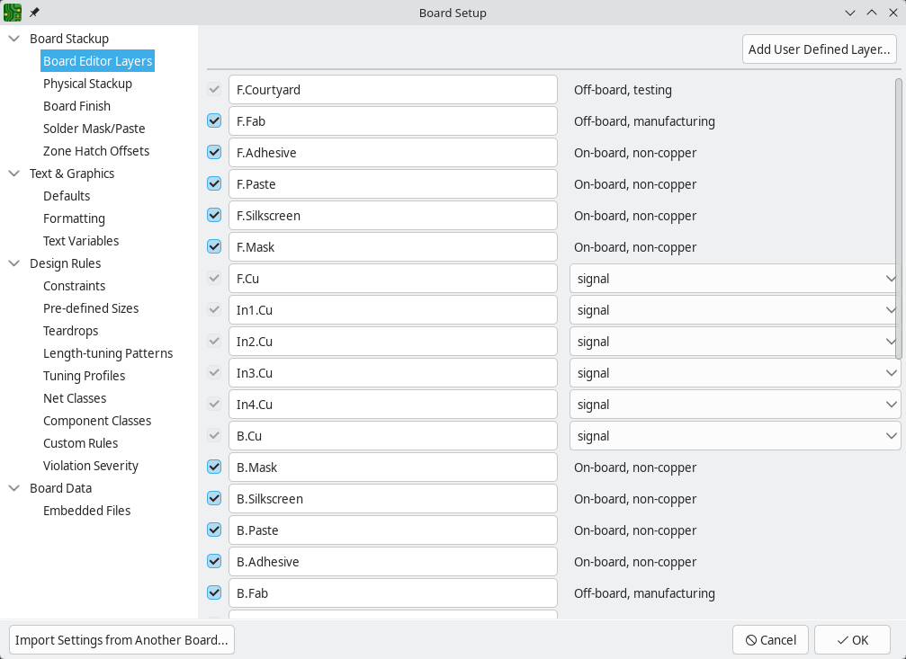

# 第 5 章：板框与叠层——机械边界、层栈和设计规则

> **开门一句话：**布局之前先定板框、层数和设计规则；先定边界，器件摆放才有依据。

## 学习目标

读完这章，你能做到：

- 用 `Edge.Cuts` 画出可制造的板框，并放置安装孔与定位基准；
- 说清两层板与四层板的差异，知道什么时候值得加层；
- 为本项目（USB-C 仅供电）建立 `Default`、`Power` 两个网类并设置线宽、间距、过孔；知道 USB 差分网类只在启用 USB 数据通信时才需要，本项目不需要；
- 用 `.kicad_dru` 写一条自定义规则，并用图形规则编辑器核对。

**难度定位：**主干段开始。本章的每个数值都会影响后面的布局与 DRC，建议先算清楚再动手。

---

## 5.1 板框与机械边界

板框（Board Outline）在 KiCad 里画在 `Edge.Cuts` 层。它决定：

- 工厂按什么形状切割；
- 铜、阻焊、丝印不能越过的边界；
- 机械外壳、安装孔、连接器的相对位置；
- DRC 的“板边间距”检查基准。

单块板先在 `Edge.Cuts` 画出闭合的外轮廓。用线段或圆弧拼接时，端点必须精确重合；不留缺口，也不让边线重叠或交叉。安装孔、圆角、工艺边按外壳和生产要求另定，并不是闭合板框的必备项。

被外轮廓完整包住的闭合轮廓，在 KiCad 里是板内挖空区。打开 **Board Area Shadow**，看该保留的板材是否有阴影、该挖掉的区域是否为空；再跑 DRC，若报 `Board has malformed outline`，跳到报告位置检查断点或重线。到工厂端还要另查铣刀能否进入窄处、内角半径是否合适。例如 [OSH Park 的板框说明](https://docs.oshpark.com/submitting-orders/board-outline/)要求内挖空留出刀具可通过的宽度，并把该类挖空按非镀铜处理；其他工厂以其工艺说明为准。

### 画板框的顺序

1. 先用卡尺量外壳、连接器、螺丝柱的实际尺寸；
2. 在 `Edge.Cuts` 上画外轮廓，单位用毫米；
3. 如需安装孔，按机械图放置并锁定位置；
4. 放连接器，确认插拔方向与外壳开孔对齐；
5. 最后才放其他器件。

> **警惕：**不要先摆满器件再“套”一个板框。板框由机械结构决定，不能拿布局剩余空间倒推。先定边界，能避免后期大面积重排。

### 坐标与原点

KiCad 的板坐标默认以左上角为原点、X 向右、Y 向下。建议把**板框左下角**设为钻孔原点（Drill Origin），这样贴片坐标和工厂沟通时更直观。设置位置在 `Place → Drill/Place File Origin`。

## 5.2 层：清楚比数量重要

两层板的基本层：

| 层 | 作用 |
| --- | --- |
| `F.Cu` | 顶层铜 |
| `B.Cu` | 底层铜 |
| `F.SilkS` / `B.SilkS` | 丝印 |
| `F.Mask` / `B.Mask` | 阻焊开窗 |
| `F.Paste` / `B.Paste` | 钢网开窗（只在有贴片时用） |
| `F.Fab` / `B.Fab` | 装配图/制造说明，不输出到板 |
| `Edge.Cuts` | 板框 |
| `Margin` | 图形/用户层，画机械边框标注；不参与 DRC 禁铜（见下方说明） |
> **术语澄清：**`Margin` 是图形/用户层，习惯上用来画机械边框标注，它**不是** DRC 强制的禁铜区；在它上面画线不会自动禁止走铜。实际禁止走线/过孔/铺铜的是**规则区（Rule Area，旧称 keepout）**：右侧工具栏 `Add Rule Area`（`Ctrl+Shift+K`），在属性对话框里勾选要禁用的对象。另外，"铜到板边间距"检查的基准是 `Edge.Cuts` 上的图形，不是 `Margin`。本项目按 40 mm × 30 mm 外形在 `Edge.Cuts` 上画闭合框即可，不需要 `Margin` 参与检查。

四层板增加 `In1.Cu`、`In2.Cu`，通常一层做完整地平面，一层做电源或第二地。层数增加的好处：

- 回流路径更短，EMC 更好；
- 布线密度更高，减少绕线；
- 阻抗控制更容易（有完整参考面）。

代价：

- 打样成本更高；
- 层叠对称性要求更严，否则可能翘曲；
- 盲埋孔工艺更复杂（普通四层通孔不需要）。

```ill
kicad-ch05-stackup
```

图 5-1 两层与四层的典型叠层。四层板的主要收益是完整参考面；多出的铜层只是实现手段。

<figure class="illu illu-photo screenshot">
<div class="illu-frame"></div>
<figcaption><span class="fig-no">图 5-2</span><span class="fig-cap">Board Setup 的 Board Editor Layers 页。铜层数量在 Physical Stackup 左上角设置；本页只管理层类型、层名和启用状态，看到 In1.Cu…In4.Cu 只说明当前已有这些层。新增铜层后还要到 Physical Stackup 填厚度、材料和铜厚，层数不等于叠层参数已经完整。</span></figcaption>
</figure>

### 什么时候值得上四层

- 有 USB 高速、以太网、DDR 等需要阻抗控制的信号；
- 板上有开关电源，需要完整地平面控制回流；
- 器件密度高，两层布不通；
- EMC 认证是硬指标。

一个常被忽略的量化理由：在 1.6 mm 两层板上，50 Ω 微带线通常要 3 mm 左右的线宽；四层板把信号层到参考面的介质压到 0.2 mm 左右，线宽才回到 0.3 mm 量级。具体值必须用 KiCad 的 `PCB Calculator` 按实际叠层算，这里给的只是数量级，不是配方。

如果只是低速 GPIO、LED、继电器，两层板通常足够。不要为了“显得专业”加层。

## 5.3 叠层参数：把“1.6 mm”拆开

板厚 1.6 mm 是常见默认值，但它由铜箔、介质、芯板叠出来的。一个典型的四层叠层可能长这样：

| 层 | 材料 | 厚度 |
| --- | --- | --- |
| 顶层铜 | 1 oz 铜 | 0.035 mm |
| 半固化片 | FR-4 prepreg | 0.10–0.20 mm |
| 内层铜 | 1 oz 铜 | 0.035 mm |
| 芯板 | FR-4 core | 1.0–1.2 mm |
| 内层铜 | 1 oz 铜 | 0.035 mm |
| 半固化片 | FR-4 prepreg | 0.10–0.20 mm |
| 底层铜 | 1 oz 铜 | 0.035 mm |

具体厚度由工厂的叠层库决定。你在 KiCad 的 `Board Setup → Physical Stackup` 里填的叠层，主要用于：

- 阻抗计算；
- 3D 视图和文档；
- 与工厂沟通“我要什么”。

实际生产时，工厂可能会用等效叠层替代。**下单前把叠层图发给工厂确认**，尤其是阻抗控制。

## 5.4 网类：给不同信号不同的尺子

网类（Net Class）是一组网络及其布线约束。KiCad 默认有一个 `Default` 网类；本项目只需再加 `Power`。KiCad 10 允许一个网络同时属于多个网类，取值时按优先级高的网类覆盖，缺少的属性回落到 `Default`。若以后做带 USB 数据的版本，再增加 `USB` 差分网类：

| 网类 | 成员 | 线宽 | 间距 | 过孔 |
| --- | --- | --- | --- | --- |
| `Default` | 普通 GPIO、LED | 0.20 mm | 0.20 mm | 0.6/0.3 mm |
| `Power` | VBUS、+5V、+3V3、GND | 0.50 mm | 0.25 mm | 0.8/0.4 mm |
| `USB`（仅当启用 USB 数据时才建） | D+、D- | 按目标阻抗/叠层计算 | 按目标阻抗/叠层计算 | 按目标阻抗/叠层计算 |

> **阅读提示：**本项目是 USB-C **仅供电**板，D+/D- 在原理图上用"未连接"标志表达、不布线，所以基线只建 `Default` 与 `Power` 两个网类；上表 `USB` 行留到做数据版本时再启用。

> **别把占位值当配方：**`USB` 行的线宽/间距/过孔必须按目标差分阻抗、铜厚、介质厚度和工厂叠层用计算器求出，再用工厂的阻抗报告复核；填错叠层，任何固定数字都不可信。

> **规则优先级（别混淆）：**规则里写的间距/线宽是"期望值"，但 `Board Setup → Constraints` 里的**最小值是硬下限**，任何网类或自定义规则都不能把它调小（例如网类填 0.1 mm、板级最小间距 0.2 mm，实际按 0.2 mm 执行）。网类的线宽/过孔尺寸只是布线的**默认值，不是最小/最大值**，手动改成别的尺寸不会触发 DRC；要强制必须用自定义规则。两处间距冲突时取**较大**的那个值。

```ill
kicad-ch05-netclass
```

图 5-3 网类让不同网络各用各的约束：本项目是电源与普通信号两类，差分属于可选扩展。线宽不是“越粗越好”，要和电流、阻抗、工艺一起看。

### 线宽与电流

铜线载流能力与铜厚、温升、环境有关。工程上常用的粗略估算：

- 1 oz 外层铜，1 A 电流，允许 10 °C 温升，线宽约 0.3–0.5 mm；
- 内层散热差，同样电流需要更宽；
- 实际设计留 50% 余量，并按 IPC-2221 或工厂建议复核。

不要凭“经验线宽”拍脑袋。把电流、铜厚、允许温升写进设计说明，再用 KiCad 的 `PCB Calculator` 或工厂计算器核对。

### 间距与电压

间距不仅看工艺最小值，还要看电压。低压 3.3 V 与 5 V 可以用默认 0.2 mm；如果板上有 24 V、48 V 或市电，必须按安规间距重新设计，并考虑爬电距离、开槽、灌封。

> **警惕：**KiCad 的 DRC 只检查你设置的规则。规则里写 0.2 mm，它就按 0.2 mm 检查；但 220 V 电路需要的间距远大于 0.2 mm。规则错，DRC 通过也不代表安全。

## 5.5 自定义 DRC 规则：把“例外”写成代码

有些约束无法用网类表达，例如：

- 某个连接器的焊盘到板边至少 1 mm；
- 某个区域不允许放过孔；
- 某两个网络之间必须保持 2 mm；
- 某类封装的最小环宽。

这些例外写进项目里的 `.kicad_dru` 文件。**不要在系统文本编辑器里直接改这个文件**：KiCad 10 规定用 `Board Setup → Custom Rules`（文本编辑页）或 `Tools → Design Rule Editor`（图形规则编辑器）维护，两者写同一个文件、可交替使用。一个完整例子如下，注意文件头 `(version 1)` 不能省：

```text
(version 1)

(rule "USB connector edge clearance"
  (constraint edge_clearance (min 1.0mm))
  (condition "A.memberOfFootprint('J1')"))
```

规则语法由约束类型、条件表达式和层范围组成。`memberOfFootprint('J1')` 是 KiCad 10 提供的表达式，用来匹配 J1 封装及其焊盘（焊盘本身没有独立的 Reference），`edge_clearance` 的“板边”取自 `Edge.Cuts` 上的图形。图形规则编辑器能覆盖间距、线宽、过孔、封装放置和若干高速约束；不在其中的约束用 `Custom Rules` 文本页写。改完点 **Check rule syntax** 检查语法，有语法错误时 DRC 根本不会运行。文件里**越靠后的规则越先被检查**，因此更具体的规则要写在后面。

> **提示：**规则名要写清用途，例如 `USB connector edge clearance`；不要用 `rule1`、`rule2`。半年后回看时，名字本身就能说明这条规则为什么存在。

## 5.6 设计规则检查的层次

DRC 规则分三层，别混在一起：

1. **板级规则**：`Board Setup → Design Rules`，线宽、间距、过孔、环宽等全局值；
2. **网类规则**：按网络分组覆盖全局值；
3. **自定义规则**：`.kicad_dru`，处理例外和特殊区域。

优先级要按三件事分别看，不要笼统记成“自定义 > 网类 > 板级默认”：① `Board Setup → Constraints` 的**最小值是硬下限**，网类和自定义规则都不能突破；② 网类给的是线宽/过孔的布线优选值；间距冲突时取较大值；③ 自定义规则最具体，但同样受硬下限约束，且文件里**从后往前**匹配，命中后不再检查后面的对象。DRC 报出意外结果时，先确认是哪一层在生效，再改数值。

```ill
kicad-ch05-rule-floor
```

图 5-4 板级最小值是地板；网类给规则值，自定义规则处理例外，但都落在这块地板之上。

## 本章小结

- 板框先于布局，必须闭合、可制造，并与外壳/连接器对齐。
- 两层板适合低速、低密度；四层板的价值主要在完整参考面与阻抗控制。
- 叠层参数要写给工厂看，1.6 mm 不是一块实心材料。
- 网类把本项目电源与普通信号分开约束（差分网类是可选扩展）；线宽要按电流和温升计算，板级最小值是硬下限；
- 自定义规则处理例外；规则名和理由要可读。

## 练习

1. 为 `usb_breath_led` 画一个 40 mm × 30 mm、四角 R2 的板框，放四个 M2.5 安装孔；确认板框在 `Edge.Cuts` 上闭合。
2. 只建 `Default` 与 `Power` 两个网类，把 VBUS、保险丝后的 `+5V`、+3V3、GND 放进 `Power`；确认 D+/D- 不参与布线。**可选：**若你另建带 USB 数据的版本，再加 `USB` 网类并把 D+/D- 归入它。
3. 写一条规则：J1（USB-C）的焊盘到板边至少 1.0 mm，以 `(version 1)` 开头，用 DRC 验证会被触发；再用规则区禁住一块不希望走线的区域。

## 验收

- 板框在 3D 视图里闭合，没有自交；
- 安装孔与外壳螺丝柱对得上；
- 基线只存在 `Default` 与 `Power` 两个网类，电源网络成员正确；若建了 `USB` 网类，D+/D- 已归入它；
- 自定义规则以 `(version 1)` 开头、通过语法检查，并能被 DRC 读取和触发；规则区禁布有效；

下一章开始摆器件。布局最能体现工程约束：同样的原理图，不同的摆放，会得到完全不同的回流路径、调试难度和制造成本。
