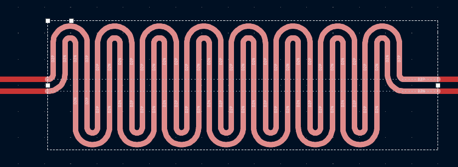

# 第 7 章：布线——单端、差分与电源

> **开门一句话：**铜线有电阻、电感和电容，也会与旁边耦合。本章先算电源线宽，再判断普通信号是否需要按高速规则处理。
> **阅读路径：**7.1–7.3、7.5、7.6 是基线必做；7.3 关于带宽、时延与拐角量级的推导也是必读的——本板会算出“不需要阻抗控制”，你需要知道为什么。7.4 的差分对、等长调谐与高速/射频内容是可选的**数据版本**扩展；范围见前言“基线范围与可选扩展”。

## 学习目标

读完这章，你能做到：

- 用边沿时间和走线长度判断一条线算不算“高速”，不要凭时钟频率猜；
- 按电流与阻抗选择线宽，不要凭“习惯”；
- 用 45° 折线、短回流路径和合理过孔完成一块两层板；
- 了解差分对的“等长、等距、连续参考面”三个条件（可选进阶，本项目不启用）；
- 用 KiCad 的布线工具（含推挤）完成 `usb_breath_led` 基线的电源、地和普通信号网络；需要时再用差分对与调长工具处理可选的数据版本；
- 说清拐角与过孔在本板（两层、慢边沿）和多层高速板上的不同量级，不把高速规则无条件套到慢速板上；

**难度定位：**主干段核心。布线是全书最需要练习的一章，建议至少重布两次。

---

## 7.1 先布电源，再布信号

推荐的布线顺序：

1. **电源与地**：`VBUS`、保险丝后的 `+5V`、`+3V3`、`GND`；
2. **关键信号**：复位；若另加外部晶振或 USB 数据，再单独处理时钟/差分（本项目基线不涉及）；
3. **普通信号**：LED、按键、ISP；
4. **铺铜与缝合**：最后统一处理地平面。

原因：电源线通常最粗、分支最多，先布能确定“主干道”；关键信号对长度/参考面敏感，越早布越有空间；普通信号可以绕，最后布。

- 基线电源路径要分清 `VBUS`、保险丝后的 `+5V` 与 LDO 输出 `+3V3`，保险丝两端不是同一网络。

## 7.2 线宽：从电流和温升倒推

铜线载流能力的简化公式（IPC-2221）：

```text
I = k × ΔT^0.44 × A^0.725
```

其中：

- `I` 是电流（A）；
- `ΔT` 是允许温升（°C）；
- `A` 是铜线截面积（mil²）；
- `k` 外层取 0.048，内层取 0.024。

工程上不必每次手算。记住几条经验，再用 [KiCad 10 的 Track Width 计算器](https://docs.kicad.org/10.0/en/pcb_calculator/pcb_calculator.html#track-width) 复核；官方文档说明它使用 IPC-2221 公式。

| 电流 | 外层 1 oz，10 °C 温升 | 内层 1 oz，10 °C 温升 |
| --- | --- | --- |
| 0.5 A | 约 0.12 mm | 约 0.30 mm |
| 1 A | 约 0.30 mm | 约 0.78 mm |
| 2 A | 约 0.78 mm | 约 2.0 mm |
| 3 A | 约 1.4 mm | 约 3.6 mm |

这些数值按 IPC-2221 公式粗算，假设无风冷、最大 10 °C 温升，且未含安全余量；实际受铜厚、环境温度、并排走线、过孔数量影响。电源入口、LDO 输入输出、地回流，建议在计算值上再加 50% 以上余量。

### 一个算例：1 A 走 30 mm

把 1 A、10 °C 温升、外层 1 oz 代入 IPC-2221：

```text
A = (1 / (0.048 × 10^0.44))^(1/0.725) ≈ 16.3 mil²
1 oz 铜厚 ≈ 1.37 mil
W = 16.3 / 1.37 ≈ 11.9 mil ≈ 0.30 mm
```

0.30 mm 是“刚好满足 10 °C 温升”的裸值，不是推荐值。加 50% 余量后取 0.45–0.50 mm；表中 1 A 对应 0.30 mm，练习里要求比较 0.50 mm，差别就在这里：一个是下限，一个是工程余量。

0.50 mm 是工程余量，不是 DRC 下限；DRC 只按板级最小值和自定义规则判断。

再看 30 mm 长、1 oz 铜的压降。下表按 20 °C 铜电阻率 1.72×10⁻⁸ Ω·m、单根矩形铜线估算；不含过孔、焊盘、回流路径和接触电阻。

| 线宽 | 电阻 | 1 A 压降 | 功耗 |
| --- | --- | --- | --- |
| 0.30 mm | 约 49 mΩ | 约 49 mV | 约 49 mW |
| 0.50 mm | 约 30 mΩ | 约 30 mV | 约 30 mW |

对 5 V 电源，49 mV 约 1%；对 3.3 V，约 1.5%。电流更大、线更长时，压降会先于温升成为约束。

反过来的算例也要看：同样 0.30 mm 外层线，按同一简化公式外推，2 A 时温升约 48 °C，3 A 时约 121 °C。1 A 的裸值不是通用线宽。这两个数是数量级警告，不是精确结温；高 ΔT 时必须用 IPC-2152、工厂数据或实测复核。

> **警惕：**过孔不是“无限通流”。一个 0.3 mm 孔径、0.6 mm 焊盘的过孔，载流能力有限；大电流路径要多个过孔并联，或直接用通孔器件引脚。

## 7.3 单端信号：先判断是不是“高速”，再谈 45°

“高速”取决于**边沿时间和走线长度**，时钟频率不能单独决定。一块 8 MHz 的板子可以有高速问题，一块 100 MHz 的板子也可能没有。所以在讨论拐角、过孔、阻抗之前，先算一次：这条线的边沿多快、走线多长、要不要当成传输线。

### 先算三个数：带宽、时延、长度门限

**第一步，边沿换成带宽。** 数字信号的能量集中在 `BW = 0.35 / RT`（`RT` 为 10–90% 上升时间）。这条关系给出的是“必须保留到多高的频率分量”，不是某个器件的带宽指标。

**第二步，走线换时延。** FR4 上的传播时延约 `170 ps/inch ≈ 6.7 ps/mm`。这是介电常数决定的量级，与线宽关系不大。

**第三步，比一比。** 常用判据是：当走线单程时延 `TD` 超过边沿时间的 20%（`TD > 0.2 × RT`）时，就必须按传输线处理，否则反射和振铃可以先不算。

| 边沿时间 `RT` | 带宽 `0.35/RT` | `TD > 0.2·RT` 对应的走线长度（FR4） |
| --- | --- | --- |
| 20 ns | 约 18 MHz | 约 600 mm |
| 2 ns | 约 175 MHz | 约 60 mm |
| 0.5 ns | 约 700 MHz | 约 15 mm |
| 0.1 ns | 约 3.5 GHz | 约 3 mm |

```ill
kicad-ch07-highspeed-gate
```

图 7-1 同一条 30 mm 走线，在三种边沿下的身份不同：慢边沿时它只是一段有电阻的铜，快边沿时它是一段必须匹配的传输线。竖线是本板最长走线（约 30 mm）的位置。

这张表能反过来当设计工具用：先量或查到驱动器的边沿时间，再查长度门限，就知道这条线要不要做阻抗控制。

**本板落在哪一格？** `usb_breath_led` 用 ATtiny85 内部 RC 振荡器（约 8 MHz），GPIO 驱动 LED 和读取按键，没有外部时钟线、没有数据总线。取 `RT = 20 ns` 作数量级假设，长度门限约 600 mm，而全板最长走线约 30 mm——差一个数量级以上，**在这个 20 ns 假设下，本板不需要阻抗控制、不需要等长、不需要仿真**。这里成立的原因是假设的边沿足够慢，30 mm 还不算长；板子小本身不能保证没事。

> **提示：**如果你给这块板加了 USB 数据、外部晶振或 SPI 屏，边沿可能降到 1–2 ns，门限随之降到 60 mm 量级；到那时同一块板、同样的走线，就要按传输线重算。判据没变，变的是输入。

### 45° 折线：一个被夸大的细节

```ill
kicad-ch07-route
```

图 7-2 90° 与 45° 折线。拐角处多出的铜面积带来附加电容；边沿较慢时影响很小。

先把量级说清楚。90° 拐角确实会造成阻抗不连续，但它来自拐角处**多出的铜面积**带来的附加电容，不是“电子来不及转弯”。对 50 Ω 线，拐角电容可以粗估为 `C ≈ 2 × w(mil)` fF：

- 0.25 mm（约 10 mil）线宽 → 约 20 fF，对应时间常数约 0.5 ps；
- 0.5 mm（约 20 mil）线宽 → 约 40 fF，对应时间常数约 1 ps。

1 ps 的扰动，对 20 ns 的边沿完全可以忽略，对 50 ps 的边沿就必须处理。所以结论是分级的：

- **本板（边沿数十 ns）**：45° 是排版习惯，不是电气要求；
- **边沿到纳秒级**：优先改成 45° 或圆弧，成本低、风险小；
- **边沿到百皮秒级**：拐角要和过孔、连接器、封装一起纳入阻抗连续性设计，光改成 45° 不够。

实操：

- 用 `Shift+Space` 切换布线角度（45°、90°、任意角）；
- 尽量用 45° 或圆弧，不要反复 90°；
- 一条线不要来回绕，长度就是寄生参数；
- 过孔数量越少越好，尤其在高频/高速线上。

### 过孔

过孔的作用是把信号从一层送到另一层。选择时看三件事：

- **孔径/焊盘**：0.3/0.6 mm 是常见默认；电源/地可以用 0.4/0.8 mm；
- **环宽**：焊盘半径减孔径半径，至少 0.15 mm（普通工艺）；
- **数量**：大电流、地连接、散热用多个并联。

过孔的电气影响要分两种情况：

- **两层板（本板）**：信号从顶层到底层只用一次，**没有残桩**。此时过孔的影响主要是焊盘与隔离孔带来的少量电容，量级在零点几 pF 以下，本板可以不管；
- **多层板**：信号只用了其中两层，剩下没走到的孔壁就是**残桩（stub）**。残桩电容可按 `5 fF/mil` 粗估：1.6 mm 板厚（约 63 mil）的贯通孔，最长残桩约 315 fF，对应约 8 ps 的时间常数。这个量级对慢边沿无害，对高速串行链路就是主要瓶颈之一，需要用盲埋孔或背钻处理。

> **警惕：**“过孔越少越好”在本板是排版习惯，在高速板上才是硬约束。过孔数量的要求取决于边沿速度，先确认前提再套用。

### 参考面

单端信号也需要返回电流。信号走在顶层，返回电流主要在同区域的底层地平面；如果底层被电源分割、被槽切断，返回电流就会绕远路，形成大环路，辐射和串扰都会增加。

所以：**布线时同时看信号层和参考层**，不要只看当前层。

### 本板线宽的阻抗量级

常见误搬是把四层板“50 Ω 参考设计”的线宽直接放到本板。两层板也可以用更宽的线宽或更薄的介质做出目标阻抗，但在本板的叠层下，这些线宽离 50 Ω 很远。本板是 1.6 mm 两层板，顶层到地层的介质厚度约 1.5 mm，用微带近似式估算：

| 线宽 | 介质厚度 | 估算特性阻抗 |
| --- | --- | --- |
| 0.25 mm | 约 1.5 mm | 约 138 Ω |
| 0.5 mm | 约 1.5 mm | 约 112 Ω |
| 1.0 mm | 约 1.5 mm | 约 86 Ω |

也就是说，0.25–1.0 mm 线宽对应 86–138 Ω；而 §5.4 的 `Default` 网类默认 0.20 mm，按同一近似式约 146 Ω。本板的普通走线按网类取 0.20 mm，因此实际更接近 146 Ω，同样离 50 Ω 很远。这不影响本板，因为边沿慢、不需要阻抗控制；但如果你照着某份“50 Ω 参考设计”的线宽直接搬到两层板上，得到的绝不是 50 Ω。若以后确实要做 50 Ω 接口，可以在两层板上用更宽线宽，也可以用更薄介质，但必须把工艺能力、布局空间和叠层参数一起重新核算，不能只改一个线宽。

> **版本差异：**KiCad 自带的 `PCB Calculator` 提供微带/带状线阻抗计算，但结果依赖你输入的介质厚度、铜厚、阻焊层与 εr。叠层参数要向板厂索取实测值，不要用“FR4 = 4.3”一路套到底。

## 7.4 差分对：等长、等距、连续参考面（可选进阶）

**先判断是否需要：**本节只适用于你要做带 USB 数据、以太网、LVDS 等高速接口的版本。本项目的供电版没有 D+/D- 网络，可以直接跳到 7.5；下面的知识留作以后扩展。
差分对（USB D+/D-、以太网、LVDS）携带的是“两根线之间的电压差”，不是单根线对地的电压。它的关键约束：

1. **等长**：两根线长度差控制在允许范围内，避免相位差；
2. **等距**：两根线间距恒定，差分阻抗才稳定；
3. **连续参考面**：下方地平面不能有槽、不能跨分割；
4. **少过孔**：过孔会引入不连续，必须时两根线同时换层。

```ill
kicad-ch07-diffpair
```

图 7-3 差分对的等长与等距（可选数据版示意）。间距由叠层和阻抗目标决定，不能靠目测。

<figure class="illu illu-photo screenshot">
<div class="illu-frame"></div>
<figcaption><span class="fig-no">图 7-4</span><span class="fig-cap">KiCad 的等长调谐走线（图示为两根并行走线同时蛇形调谐，即差分对；单端才只调一根）。先把目标长度与公差写进规则，再用蛇形段补足；调谐后跑 DRC 复核，不能只凭目测。</span></figcaption>
</figure>

KiCad 的差分对布线：

- 先在原理图把两根线命名为同名基名加后缀：`USB+`/`USB-` 或 `USB_P`/`USB_N`（两种风格不能混用）；否则 PCB 里不成对，差分工具不认；
- 在 `Board Setup → Net Classes` 里给该网类设置差分对间距（`Diff Pair Gap`）与线宽；
- 用顶部工具栏 `Route` 下拉菜单里的 `Route Differential Pair`，或右侧工具栏（默认热键 `6`）；从正端或负端焊盘都能起步；
- 检查长度差：用自定义 DRC 规则设目标长度/偏差后运行 `Inspect → Design Rules Checker`；也可激活调谐工具（差分对长度调谐热键 `8`、偏斜调谐热键 `9`）悬停查看实时数值与目标值；`Inspect → Constraints Resolution` 可看某对象适用的约束。注意 KiCad 的 `Inspect` 菜单**没有** “Diff Pair” 这一项；
- 需要补偿时用 `Tune length` 工具：单线长度调谐热键 `7`、差分对长度调谐 `8`、差分对偏斜调谐 `9`，用蛇形走线加长。

> **版本差异：**KiCad 10 重做了长度调谐系统，支持时间域约束与 Tuning Profile。旧版本只有长度域，且路由器与 DRC 的算法可能不完全一致；升级后要重新核对调谐结果。

USB 2.0 全速（12 Mbps）对差分对的要求相对宽松，但“等长、等距、连续参考面”仍然适用。USB 3.x 的速率高得多，必须按叠层做阻抗控制。

## 7.5 电源与地：回流路径比线宽更重要

电源布线的常见错误是只关注“线够不够粗”，忽略“回流从哪里回”。

### 电源树

把电源画成一棵树，而不是一张网：

USB-C `VBUS`
  └── 保险丝 → `+5V` → LDO IN
                          └── LDO OUT `+3V3` → MCU / LED
                               （其它负载仅在扩展设计时添加）

每个分支的电流不同，线宽也应不同。LDO 输入电容、输出电容尽量靠近引脚，形成小环路。

### 地

两层板的地通常有两个选择：

- **铺铜**：在底层铺 GND，顶层也铺 GND，用过多过孔缝合；
- **地线**：不铺铜，用粗线走地。

对于教学板，建议底层完整铺 GND，顶层在空白处铺 GND，并在关键位置加缝合过孔。完整地平面能提供低阻抗回流路径，也便于屏蔽。

> **警惕：**不要故意把地平面切成“数字地/模拟地”两块再单点连接，除非你有明确理由和测量手段。盲目分割会让回流电流绕路，反而更差。混合信号设计应优先“分区不分割”，把模拟器件集中在一处，地平面保持完整。

## 7.6 推挤、锁线与交互式布线

KiCad 的交互式布线器支持：

- **推挤（Push and Shove）**：新线把已有线推开，保持间距；
- **绕障（Walk Around）**：沿障碍物边缘走；
- **锁线**：锁定关键线，避免被推挤；
- **高亮网络**：选中铜线后按反引号键（键盘左上角、与 ~ 同键，不按 Shift）高亮同一网络的所有对象；按 `~` 是**清除**高亮，别按反；

建议：

- 先布关键线并锁定；
- 再用推挤布普通线；
- 每次推挤后检查是否有线被推到不合理的位置；
- 布线完成后统一跑 DRC，不要边布边忽略。

## 7.7 布线完成的最低标准

- 所有飞线消失（没有未连接网络）；
- 电源线宽满足电流要求；
- 关键信号有连续参考面；
- 差分对等长/等距（仅当启用了差分对时）；
- 过孔数量合理，没有孤立的过孔；
- 没有明显的“天线”（悬空铜线、长支线）；
- DRC 零错误（警告逐条解释）。

## 本章小结

- 布线顺序：电源与地 → 关键信号 → 普通信号 → 铺铜。
- 线宽由电流、铜厚、温升决定；过孔也要考虑载流。
- “高速”由边沿时间和走线长度决定：`BW = 0.35/RT`，`TD > 0.2·RT` 就要当传输线；FR4 上约 6.7 ps/mm。本板边沿数十 ns、最长走线约 30 mm，不在高速区间。
- 拐角与过孔的影响有量级：拐角约 20–40 fF（0.5–1 ps），两层板无残桩，多层板的残桩约 5 fF/mil；先算量级，再决定要不要改。
- 单端信号用 45°、少过孔、连续参考面。
- 本板普通走线按 §5.4 取 0.20 mm，微带近似约 146 Ω；0.25–1.0 mm 对应 86–138 Ω，都不是 50 Ω；两层板也能做 50 Ω，但要按目标阻抗重新选线宽、介质厚度和工艺。
- 差分对要等长、等距、连续参考面；KiCad 10 支持时间域调谐（可选进阶）；
- 电源的关键在“树状分配 + 小回流环路”，线宽粗只是其中一项；地平面优先完整。
- 供电链区分保险丝前的 `VBUS`、保险丝后的 `+5V` 与 LDO 输出 `+3V3`；两侧不能用同一网络名。

## 练习

1. 按 1 A 电流计算外层 1 oz、10 °C 温升所需的线宽，先自己算，再对照 7.2 的算例；说明为什么最终取 0.50 mm，而不是 0.30 mm。
2. 布完 `usb_breath_led` 的电源和地，检查每个去耦电容的回路面积。
3. 沿主电源路径核对 `VBUS → 保险丝 → +5V → LDO → +3V3`，确认保险丝前后的网络名没有被同名标签合并。
4. **算一次“是不是高速”**：假设你把 MCU 换成一颗 `RT = 1 ns` 的器件，板子不变（最长走线约 30 mm），用 7.3 的表格判断这条线是否已进入传输线区间；再算出这时 30 mm 走线的时延是多少 ps。
5. **可选进阶（数据版本）**：用差分对工具布 USB D+/D-，故意让一根线多绕 5 mm，用 DRC 规则或调谐工具观察长度差；本供电版可跳过此题。

## 验收

- 所有网络连通，DRC 无未连接；
- 电源线宽有计算依据；
- 你能用自己的话算出本板最长走线为什么不需要阻抗控制，并说出边沿变快后判据怎么变；
- 若做了差分数据版本：差分对长度差在设定范围内；本供电版此项不适用；
- 地平面完整，没有把回流路径切断的槽；
- 你能指出每一根关键线的返回电流走哪条路径。
- 原理图与 PCB 中保险丝前后的网络分别为 `VBUS`、`+5V`；

下一章铺铜并检查回流路径。重点看地平面是否连续，以及过孔、开槽和焊盘是否切断返回路径。
