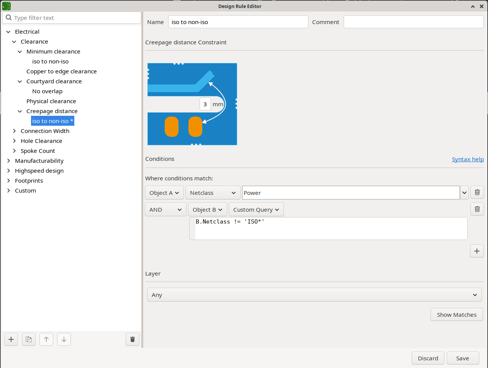

# 第 9 章：DRC 与可制造性——把错误拦在发板前

> **开门一句话：**DRC 通过不等于“能做出来”，更不等于“电路接对了”。DRC 是规则检查，电气正确要靠人工判断，能不能稳定做出来要看工厂能力——三者都要过，但不能用其中一个代替另外两个。

> **分清三类结论，别互相替代：**① **DRC** 按工程规则检查几何与网表连通性，可自动化、有退出码；② **电气确认**回答“接得对不对、值对不对、回流好不好、极性对不对”，工具不会替你判断，靠人工走查与上电验证；③ **工厂能力**是产线工艺极限与余量，靠 DFM 表和与工厂沟通确定。`usb_breath_led` 的 LED 限流电阻取值、KEY 低电平有效、USB-C 的 CC1/CC2 独立 5.1 kΩ 下拉、铺铜后的参考面连续性，都属于第②类——DRC 零违规不会覆盖它们。

## 学习目标

读完这章，你能做到：

- 读懂 DRC 报告中的“规则—对象—数值—位置”四要素；
- 用 `kicad-cli pcb drc` 做命令行检查，并把退出码接进脚本；
- 识别常见的 DFM 问题：环宽、阻焊桥、丝印压焊盘、板边距、孔到铜；
- 用自定义规则和图形规则编辑器表达“工厂要求”。

**难度定位：**主干段收尾。本章是“设计”到“制造”的门槛。

---

## 9.1 DRC 报告怎么读

一条 DRC 违规通常包含：

| 要素 | 例子 | 你要问的 |
| --- | --- | --- |
| 规则 | `Clearance` | 哪条规则被触发？ |
| 对象 | `Track [GND] on F.Cu` / `Pad 1 of J1` | 具体是哪个对象？ |
| 数值 | `0.15 mm < 0.20 mm` | 实际值、要求值各是多少？ |
| 位置 | 坐标/层 | 去图上看，是布局问题还是布线问题？ |

```ill
kicad-ch09-drc
```

图 9-1 DRC 报告与板图上的标记。每一条都要能回答“哪条规则、哪个对象、为什么”。

### 严重程度

- **Error**：违反硬规则，必须修；
- **Warning**：可能有问题，需要判断；
- **Exclusion**：主动排除的项。GUI 里默认隐藏，勾选 Exclusions 才显示；命令行 `--severity-all` / `--severity-exclusions` 会把它写进报告。排除只改变显示与统计，不改变违规的几何事实。

不要靠“全部排除”把报告清空。对确属合理的例外，用右键 `Exclude with comment…` 写明理由并保留在报告中供复核；但排除不是修复，几何/连接问题必须改到违规消失。

> **现场片段：**一位读者跑完 DRC，看到 `Violations` 标签是 0，就把报告存了。后来在 `Unconnected Items` 标签里发现，PB3 到 330 Ω 电阻还有一条飞线——他只看了一个标签页。若就这样发板，LED 支路在 PCB 上就是断的。补上那段线，按 `B` 重填铺铜，再跑 DRC，两个标签都清零。DRC 的“通过”，必须把所有标签都看完——第 4 个 `Ignored Tests` 标签存放已忽略测试；`Schematic Parity` 只有在勾选 `Test for parity between PCB and schematic` 且 PCB 编辑器随工程运行时才有内容。

## 9.2 常见 DRC 违规与处理

| 违规 | 常见原因 | 处理 |
| --- | --- | --- |
| `Clearance violation` | 线太近、焊盘太近 | 移动/加宽间距，或确认规则是否过严 |
| `Track width` | 线宽低于板级最小线宽，或违反自定义规则下限 | 加宽，或按实际工艺调整板级约束；注意网类线宽只是布线优选值，不会单独触发 DRC |
| `Hole size out of range` | 钻孔直径低于板级最小值，或超出规则范围（含过孔/通孔，不含微孔） | 改孔径，或与工厂确认最小钻头 |
| `Annular width` | 环宽低于最小值，或超出规则范围 | 增大焊盘/减小孔径，或核对规则 |
| `Hole clearance violation` | 孔到铜太近 | 移孔或加间距 |
| `Board edge clearance violation` | 铜到板边太近 | 内缩，或确认工厂能力 |
| `Courtyards overlap` | 器件占位重叠 | 移动器件；如果是故意，检查是否真的能装 |
| `Silkscreen clipped by solder mask` | 丝印压到阻焊开窗/焊盘 | 移丝印，或让工厂 clipping |
| `Unconnected Items`（对话框标签） | 网络未连 | 布线/铺铜/检查网表 |
| `Schematic parity` 检查 | PCB 与原理图不一致（仅在启用 parity 且随工程运行时检查） | 重新导入网表，检查封装/引脚 |

> **警惕：**`Courtyards overlap` 不一定是错。有些器件可以叠放（例如模块下方的测试点），但必须有明确理由。默认把它当错误，能避免“装不上”的返工。

### 9.2.1 动手做一遍：从故意违规到证据化修复

用第 5 章的 `Default` 网类（线宽 0.20 mm）走一遍闭环，重点是学会读报告；具体数字不必死记。

1. **先定判据。**在 `File → Board Setup → Design Rules → Constraints` 里把最小线宽设为 0.15 mm（与 9.4 节工厂能力一致）。这步不能省：KiCad 把网类线宽当作布线默认的“优选值”，手动改线宽本身不会触发 DRC；只有板级最小值或自定义规则才产生下限。
2. **制造违规。**选一段 `Default` 网络的走线（例如 PB3 到 LED 电阻的连线），按 `E` 打开属性，把线宽改成 0.10 mm。
3. **跑检查并读报告。**`Inspect → Design Rules Checker`（或 `kicad-cli pcb drc --refill-zones`）。报告出现一条 `Track width` 错误：规则名 `Track width`，对象是 `Track [...] on F.Cu`，数值类似 `0.10 mm < 0.15 mm`，并可点击定位到坐标/层。把这四个要素抄进笔记——这就是 9.1 的“规则—对象—数值—位置”。
4. **修复并重跑。**把线宽改回 0.20 mm，按 `B` 重新填充铺铜，再跑一次 DRC，确认这条消失、错误计数归零，并保存报告（`Save…` 按钮或 `--output`）。
5. **不要把“排除”当成功。**右键这条违规的 `Exclude this violation` 只是把这一条在默认视图里隐藏；若它来自自定义规则，右键还可能看到 `Exclude all violations of rule`，效果一样是把同类违规隐藏。`Exclude with comment…` 会连同理由留在报告里供别人复核。这些动作都没有改变 0.10 mm 的走线：只有第 4 步的几何修复才让违规消失。

把这套读法带回第 8 章：铺铜后的连通性问题同样要看对象与位置，不能只数红叉。

## 9.3 命令行 DRC 与退出码

```bash
kicad-cli pcb drc usb_breath_led.kicad_pcb \
  --output drc.rpt \
  --severity-all \
  --schematic-parity \
  --exit-code-violations
```

关键选项：

- `--schematic-parity`：检查 PCB 与原理图是否一致（封装、网络、参考号）；
- `--exit-code-violations`：有违规时返回 5，方便 CI 阻断；
- `--refill-zones`：先重新填充铺铜再检查（不加 `--save-board` 时不会把填充写回板文件）；
- `--format json`：输出 JSON，便于脚本处理；
- `--severity-exclusions`：把已排除项也写进报告；配合 `--severity-all` 可看到全部严重程度的结果。

在 CI 里，通常先跑 ERC，再跑 DRC，最后才导出制造文件。顺序不能反：文件导出后再发现 DRC 错误，已经浪费了一次构建。注意退出码 0 只表示“没有违反已配置的规则”，不是“电路电气正确”。

## 9.4 DFM：工厂关心什么

DFM（Design for Manufacturability）是“设计能不能被稳定制造”。常见工厂能力参数（以普通两层/四层 FR-4 为例）如下——这些是**和工厂确认的输入**，不是 KiCad 自动检查的默认值；要把确认后的数值写进 Board Setup 约束或 9.6 的自定义规则，DRC 才会守卫它们：

| 参数 | 常见能力 | 设计建议 |
| --- | --- | --- |
| 最小线宽/间距 | 0.10–0.15 mm | 不要压到极限，留 20% 余量 |
| 最小孔径 | 0.2–0.3 mm | 0.3 mm 更稳 |
| 环宽 | ≥ 0.05 mm（极限），0.15 mm 更稳 | 焊盘半径 = 孔径/2 + 环宽 |
| 阻焊桥 | ≥ 0.1 mm | 细间距焊盘间容易连桥 |
| 板边距 | ≥ 0.2–0.3 mm | 铣边公差会吃掉铜 |
| 孔到铜 | ≥ 0.25 mm | 避免钻孔伤铜 |
| 丝印最小线宽 | 0.15 mm | 太细会糊 |
| 阻焊开窗单边 | 0.05–0.1 mm | 太大露铜，太小盖焊盘 |

```ill
kicad-ch09-dfm
```

图 9-2 DFM 的四个关键尺寸：环宽、阻焊开窗、钢网开口、丝印避让。

### 环宽怎么算

```text
环宽 = (焊盘直径 - 孔径) / 2
```

例如孔径 0.3 mm、焊盘 0.6 mm，环宽 = 0.15 mm。如果工厂极限是 0.05 mm，这个设计有余量；如果焊盘只有 0.4 mm，环宽 = 0.05 mm，已经在极限上。

### 阻焊桥

阻焊桥要按板厂的最小工艺能力核对。间隙不足时，工厂可能建议合并相邻开窗；合并会取消焊盘间的阻焊隔离，但是否连锡还取决于焊盘几何、钢网厚度、锡膏量与组装工艺。细间距 IC 的焊盘间阻焊桥尤其要注意：

- 0.5 mm 间距的 QFP，焊盘间阻焊桥可能只有 0.15–0.2 mm；
- 让板厂确认是否会合并开窗，并与组装厂核对钢网、锡膏量和工艺；必要时按双方能力调整封装或装配方案。

### 丝印

丝印不要压焊盘，不要压过孔（尤其是未盖油的过孔），不要细到看不清。丝印的作用是装配和维修，不是装饰。

## 9.5 拼板与工艺边

单板打样通常不需要拼板；批量生产时，拼板能提高效率。拼板要考虑：

- 工艺边宽度（通常 5 mm 以上）；
- V-Cut 或邮票孔的位置；
- 器件到拼板边界的距离；
- 贴片机的传送方向；
- 分板后的毛刺。

KiKit 是社区常用的拼板工具，可以生成面板、工艺边、V-Cut/邮票孔，并导出制造文件。使用前先确认工厂支持的拼板方式。

## 9.6 自定义规则：把工厂要求写进工程

自定义规则保存在 `.kicad_dru` 文件里，KiCad 10 要求文件以 `(version 1)` 开头。例如“J1 的焊盘到板边至少 1 mm”：

```text
(version 1)
(rule "J1 edge clearance"
  (constraint edge_clearance (min 1.0mm))
  (condition "A.Reference == 'J1'"))
```

再例如“USB 差分对之间不超过 0.15 mm 间距”（**示例模板**：本板 USB 仅供电、没有差分对，不是本板要求）：

```text
(rule "USB diff pair gap"
  (constraint diff_pair_gap (max 0.15mm))
  (condition "A.NetClass == 'USB'"))
```

再例如“把散热焊盘改为实心连接”，用 `zone_connection` 覆盖铺铜的默认连接方式（`solid` / `thermal_reliefs` / `none`）：

```text
(rule "heatsink pad solid"
  (constraint zone_connection solid)
  (condition "A.Fabrication_Property == 'Heatsink pad'"))
```

前提是该焊盘带有 `Heatsink pad` 制造属性；没有这个属性的焊盘仍按铺铜自身的 `Pad connection` 设置。

文本规则在 `File → Board Setup → Design Rules → Custom Rules` 里编辑，改完点 `Check rule syntax`——语法错误会让 DRC 完全无法运行。也可以用 `Tools → Design Rule Editor` 打开图形设计规则编辑器，用表单创建间距、线宽、过孔等规则；两种方式写进同一个 `.kicad_dru`。团队应把 `.kicad_dru` 和工程一起提交，并在工程的说明文件里写明每条规则的来源（工厂工艺、公司规范、器件手册）。

<figure class="illu illu-photo screenshot">
<div class="illu-frame"></div>
<figcaption><span class="fig-no">图 9-3</span><span class="fig-cap">Design Rule Editor 的图形规则界面。左侧选规则类型，右侧填名称、条件和约束；Syntax help 只解释语法，保存后仍要回到 DRC 确认规则真的命中了目标对象。</span></figcaption>
</figure>

## 9.7 发板前的检查清单

- ERC 零错误，警告逐条解释；
- DRC 零错误（已重新填充），警告与排除项逐条解释；排除不是修复；
- 人工电气确认：LED 限流电阻取值、KEY 低电平有效、CC1/CC2 独立下拉、参考面连续（DRC 不覆盖这些）；
- 原理图与 PCB 的封装/网络一致（`--schematic-parity`）；
- 所有铺铜已重新填充；
- 板框闭合，安装孔/定位孔齐全；
- 丝印不压焊盘，位号可读；
- 基准点（如需要）已放置；
- 制造文件参数与工厂能力表逐项对得上，并已与工厂确认。

```ill
kicad-ch09-three-gates
```

图 9-4 DRC、电气确认、工厂能力是三道独立的门；任何一道没过，都不应发板。首次打样前没有实物板，电气确认是原理图、器件参数与回流的纸面走查；上电验收在第 12 章。DRC 的 0/5 是启用 `--exit-code-violations` 后的结果；工具运行错误是另一类失败。

## 本章小结

- DRC 报告要读“规则—对象—数值—位置”，不要只看红叉；排除项不等于修复；
- 命令行 DRC 可以接进 CI，`--exit-code-violations` 提供阻断能力；退出码 0 只说明没有违反已配置规则；
- DRC（规则）、电气走查（接得对）、工厂能力（做得出）是三道不同的关，不能互相替代；
- 网类线宽/过孔尺寸只是优选值，只有板级最小值或自定义规则才形成 DRC 下限；
- DFM 关注线宽/间距、孔径/环宽、阻焊桥、板边距、丝印；设计要留余量；
- 自定义规则把工厂要求固化进工程，图形编辑器降低门槛；发板前检查清单是最后一道人工闸门。

## 练习

1. 按 9.2.1 的步骤，把一段 `Default` 网络走线改成 0.10 mm，跑 DRC 并记录规则/对象/数值/位置；修复后重跑至零违规。再把同一条违规 Exclude，说明为什么这不是修复。
2. 计算一个 0.3 mm 孔径、0.55 mm 焊盘的环宽；判断是否满足 0.15 mm 目标。
3. 写一条规则限制 J1 到板边 1 mm（记得 `(version 1)` 头），用 `Check rule syntax` 验证后，故意把 J1 移近板边，确认 DRC 能触发该规则。

## 验收

- DRC 报告中每条剩余项（警告与排除项）都有解释；排除项不是本可用几何修复消除的合理例外；
- 你能说明 DRC 零违规为什么不能替代电气走查与工厂能力确认；
- 制造文件的参数与工厂能力表对得上；
- 丝印、阻焊、环宽没有压极限；
- 你能把一条工厂要求翻译成带 `(version 1)` 头的 `.kicad_dru` 规则，并验证 DRC 能触发它。

下一章把这些检查变成文件：Gerber、钻孔、BOM、贴片坐标。制造文件是工厂生产的依据，不能当成导出的附件。