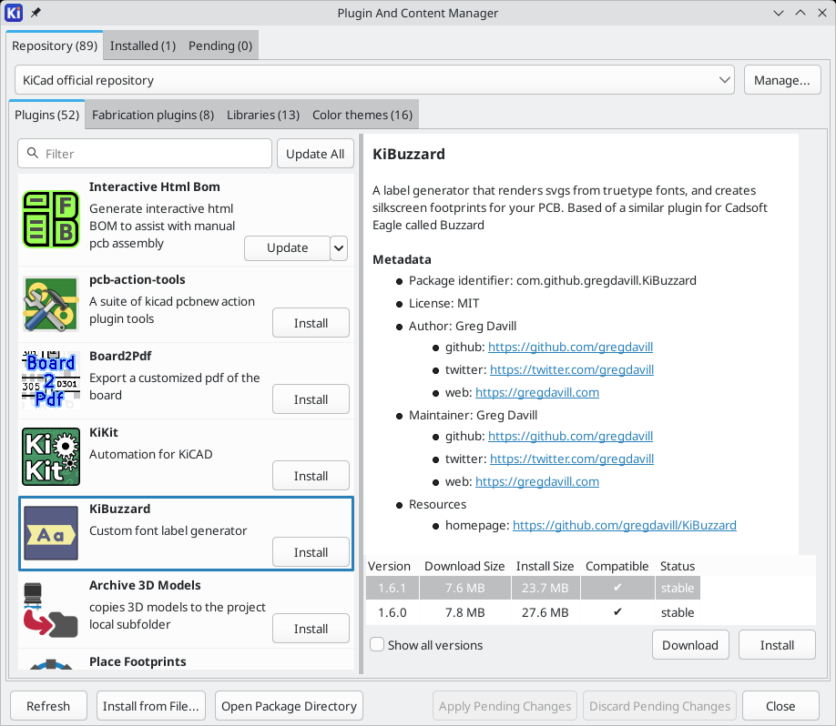

# 第 15 章：自动化与插件——kicad-cli、Python API 与 CI

> **开门一句话：**自动化把 ERC、DRC 和制造输出放进同一流程。本章先跑通 kicad-cli，再接 Python API、插件和 CI。

## 学习目标

读完这章，你能做到：

- 用 `kicad-cli` 在脚本/CI 里完成 ERC、DRC、Gerber、钻孔、坐标、BOM 输出；
- 用 Python（`pcbnew` 或 IPC API）读取/修改板级对象；
- 了解 KiCad 插件系统（PCM）与社区工具的适用边界；
- 用固定版本的 KiCad 10.0.8 容器在 GitHub Actions 跑 ERC/DRC，失败阻断制造文件导出并保留报告；
- 直接复用 KiBot 的 GitHub Action 与 `.kibot.yaml`，并说清 action、镜像和 KiCad 补丁版各自的固定边界；

**难度定位：**进阶篇收尾。本章假设你已经能独立完成一块板，重点在“把流程固化”。

---

## 15.1 为什么需要自动化

手工操作的三个问题：

1. **不可复现**：不同人、不同时间，点的菜单可能不同；
2. **不可验证**：没有记录“这次导出用了什么参数”；
3. **不可扩展**：每多一个版本，就多一次重复劳动。

自动化的目标：

- 把“检查”变成退出码；
- 把“导出”变成命令；
- 把“交付”变成带版本号的产物；
- 把“经验”变成脚本里的规则。

```ill
kicad-ch15-automation
```

图 15-1 固定 KiCad 10.0.8，版本守卫与 ERC/DRC 通过后才导出；失败时仍归档诊断报告。

## 15.2 kicad-cli：命令行入口

`kicad-cli` 是官方命令行工具，覆盖：

- `sch erc`：原理图电气检查；
- `sch export bom/netlist/pdf/svg`：原理图输出；
- `pcb drc`：PCB 设计规则检查；
- `pcb export gerbers/drill/pos/step/svg/pdf/ipc2581/odb`：制造与文档输出（`odb` 即 ODB++）；
- `jobset run`：运行预定义作业集；
- `fp/sym upgrade/export`：库升级/导出。

一个最小构建脚本：

```bash
#!/usr/bin/env bash
set -euo pipefail

PROJ="usb_breath_led"
OUT="fab"

if [ -e "$OUT" ] || [ -L "$OUT" ]; then
  echo "$OUT already exists; move it aside or set OUT to a fresh directory." >&2
  exit 1
fi
mkdir -p "$OUT"

kicad-cli sch erc "$PROJ.kicad_sch" \
  --output "$OUT/erc.rpt" --severity-all --exit-code-violations

kicad-cli pcb drc "$PROJ.kicad_pcb" \
  --output "$OUT/drc.rpt" --severity-all --schematic-parity --exit-code-violations

kicad-cli pcb export gerbers "$PROJ.kicad_pcb" \
  --output "$OUT/gerbers/" \
  --layers "F.Cu,B.Cu,F.SilkS,B.SilkS,F.Mask,B.Mask,Edge.Cuts" \
  --use-drill-file-origin

kicad-cli pcb export drill "$PROJ.kicad_pcb" \
  --output "$OUT/" --format excellon --drill-origin plot \
  --excellon-units mm --generate-map

kicad-cli pcb export pos "$PROJ.kicad_pcb" \
  --output "$OUT/$PROJ-pos.csv" --format csv --units mm --use-drill-file-origin

kicad-cli sch export bom "$PROJ.kicad_sch" \
  --output "$OUT/$PROJ-bom.csv" \
  --fields "Reference,Value,Footprint,QUANTITY,MPN,Manufacturer,DNP" \
  --labels "Refs,Value,Footprint,Qty,MPN,Manufacturer,DNP"

kicad-cli pcb export step "$PROJ.kicad_pcb" \
  --output "$OUT/$PROJ.step" --subst-models --no-dnp
```

注意：

- `set -euo pipefail` 让任何一步失败立即停止；
- `--exit-code-violations` 让 ERC/DRC 失败变成非零退出码；
- 脚本拒绝覆盖已有 `fab/`；需要重建时先手动移走旧包，或改用新的 `OUT` 目录，避免误删已有制造文件；
- 所有输出路径都写死，避免“这次文件去哪了”。

> **提示：**`kicad-cli` 的具体选项会随版本变化。CI 里把 `kicad-cli version` 和 `--help` 输出一起存档，出问题时能知道当时用的是哪一版。

## 15.3 Python API：两条路线

### 路线一：`pcbnew` 模块

KiCad 自带 Python 环境，`import pcbnew` 可以读写板文件。常见用途：

- 批量修改丝印/位号；
- 统计板上的器件/网络；
- 生成自定义报表；
- 自动放置测试点/过孔。

示例：列出所有封装及位置：

```python
import pcbnew

board = pcbnew.LoadBoard("usb_breath_led.kicad_pcb")
for fp in board.GetFootprints():
    pos = fp.GetPosition()
    print(fp.GetReference(), fp.GetValue(),
          pcbnew.ToMM(pos.x), pcbnew.ToMM(pos.y))
```

`pcbnew` 的 API 覆盖范围广，既可在 KiCad 的 Python 控制台里交互运行，也可在独立脚本中加载板文件；它依赖与 KiCad 匹配的 Python 环境和 `pcbnew` 模块。版本间可能有差异，脚本要记录 KiCad 版本。

### 路线二：IPC API（kicad-python）

KiCad 9.0 起提供的 IPC API，允许外部进程通过套接字与运行中的 KiCad 通信。当前版本的能力与连接步骤以 [kicad-python 文档](https://docs.kicad.org/kicad-python) 为准。适合：

- 与 GUI 同时操作；
- 实时查询/修改；
- 编辑器插件；
- 不想依赖 `pcbnew` 模块与 KiCad Python 环境。

`kicad-python` 是官方 Python 客户端。使用前要：

- 在 KiCad 中启用 IPC API；
- 启动 KiCad 并打开工程；
- 用客户端连接；
- 处理版本/协议兼容。

```ill
kicad-ch15-plugin
```

图 15-2 四条自动化入口：命令行管批处理，`pcbnew` 管板级操作，IPC 管实时会话，PCM 管分发。

> **版本差异：**`pcbnew` 是传统脚本接口，覆盖广，但依赖与 KiCad 匹配的 Python 环境和 `pcbnew` 模块；IPC API 是新的跨进程接口，能力逐步扩展。选择时看“是否需要在 GUI 运行时操作”，而不是“哪个更新”。

## 15.4 插件系统（PCM）

KiCad 的 Plugin and Content Manager（PCM）可以安装/更新插件、符号库、主题等。插件可以是：

- Python 脚本（`pcbnew` Action Plugin）；
- 外部工具封装；
- 内容包（库、模板、颜色主题）。

PCM 安装的插件由 KiCad 管理；手动安装时，每个插件放在平台对应的 `scripting/plugins/` 目录下的独立文件夹（Windows/macOS 在 `Documents/KiCad/10.0/scripting/plugins`，Linux 在 `~/.local/share/kicad/10.0/scripting/plugins`）。团队内部可以用 PCM 兼容的仓库分发私有插件，但要注意：

- 插件会执行代码，安装前确认来源；
- 插件版本要与 KiCad 主版本匹配；
- 插件输出要能被 DRC/人工复核，不能“黑箱改板”。

<figure class="illu illu-photo screenshot">
<div class="illu-frame"></div>
<figcaption><span class="fig-no">图 15-3</span><span class="fig-cap">Plugin and Content Manager 的 Repository 页。左列可见 InteractiveHtmlBom、KiKit 等社区插件（右侧当前选中的是 KiBuzzard）；插件、库与主题在同一入口安装，安装前仍要核对来源、版本与许可，装好后先用可丢弃的板验证它改了哪些对象。</span></figcaption>
</figure>

## 15.5 社区工具：把重复工作交给别人

几个常用的社区工具：

| 工具 | 作用 | 适用 |
| --- | --- | --- |
| InteractiveHtmlBom | 生成可交互的装配 BOM/位号图 | 手工焊接、维修 |
| KiKit | 拼板、面板化、制造输出 | 小批量 |
| KiBot | ERC/DRC 预检 + Gerber/钻孔/坐标/BOM 的声明式流水线，提供 GitHub Action | 想复用现成 CI、接受其镜像的 KiCad 10.x 补丁版 |
| kicad-jlcpcb-tools | BOM/CPL 整理与 JLCPCB 下单 | 该平台用户 |
| kicad-python | IPC API 客户端 | 自动化/插件 |

使用原则：

- 先确认它输出的文件与你的工厂模板一致；
- 不要用它替代 DRC/ERC；
- 记录版本与配置，保证可复现；
- 插件生成的板子要重新跑 DRC。

## 15.6 最小 CI：固定版本、先检查再导出

把下列文件保存到自己工程仓库的 `.github/workflows/kicad.yml`。前提是仓库根目录已有读者自己建立的 `.kicad_pro`、`.kicad_sch`、`.kicad_pcb`、项目库表和自建 `lib/`；本书不提供这个工程文件。这里用 KiCad 项目维护的 `kicad/kicad:10.0.8` 镜像，把 CI 版本固定到精确补丁版，并在构建开始时再核对 `kicad-cli version`。

> **版本提醒：**下面的 action 版本按 2026-11 的当前主版本写（`checkout` v7、`upload-artifact` v7），KiCad 镜像也只锁到 `10.0.8` 标签。因此这是一个**版本受约束、但不是完全可复现**的入门示例：主版本标签会跟随补丁版，镜像标签也可能被重新发布。团队项目应再锁一层：从 action 的 release 页复制完整 commit SHA，替换 `@v7`；用 `docker buildx imagetools inspect kicad/kicad:10.0.8` 取得镜像 digest，把镜像引用改成 `kicad/kicad@sha256:<digest>`。没有核实过的 SHA 或 digest 不要凭空填。

```yaml
name: KiCad design checks
on: [push, pull_request]

jobs:
  kicad:
    runs-on: ubuntu-24.04
    steps:
      - uses: actions/checkout@v7
      - name: Check and export with KiCad 10.0.8
        run: |
          docker run --rm \
            --user "$(id -u):$(id -g)" \
            --env HOME=/home/kicad \
            --volume "$GITHUB_WORKSPACE:/work" \
            --workdir /work \
            kicad/kicad:10.0.8 \
            bash -euc '
              mkdir -p fab/gerbers
              version="$(kicad-cli version)"
              printf "%s\n" "$version" > fab/kicad-cli-version.txt
              test "$version" = "10.0.8"
              printf "%s\n" \
                "Project: usb_breath_led" \
                "KiCad version: $version" \
                "Source commit: $(git rev-parse --short HEAD)" \
                "Units: mm" \
                "Drill/place origin: shared by Gerber, drill and POS exports" \
                "Board stackup and surface finish: verify against factory order before release" \
                "Special process: state any impedance, panelization or controlled-depth requirements" \
                > fab/README.txt

              kicad-cli sch erc usb_breath_led.kicad_sch \
                --output fab/erc.rpt --severity-all --exit-code-violations
              kicad-cli pcb drc usb_breath_led.kicad_pcb \
                --output fab/drc.rpt --severity-all --schematic-parity \
                --refill-zones --save-board --exit-code-violations

              kicad-cli pcb export gerbers usb_breath_led.kicad_pcb \
                --output fab/gerbers/ \
                --layers "F.Cu,B.Cu,F.SilkS,B.SilkS,F.Mask,B.Mask,Edge.Cuts" \
                --subtract-soldermask --use-drill-file-origin \
                --no-protel-ext --no-x2
              kicad-cli pcb export drill usb_breath_led.kicad_pcb \
                --output fab/ --format excellon --drill-origin plot \
                --excellon-units mm --generate-map --map-format gerberx2
              kicad-cli pcb export pos usb_breath_led.kicad_pcb \
                --output fab/usb_breath_led-pos.csv --format csv --units mm \
                --use-drill-file-origin --side both
              kicad-cli sch export bom usb_breath_led.kicad_sch \
                --output fab/usb_breath_led-bom.csv \
                --fields "Reference,Value,Footprint,QUANTITY,MPN,Manufacturer,DNP" \
                --labels "Refs,Value,Footprint,Qty,MPN,Manufacturer,DNP"
            '
```

同一个文件的后半段（接着上面的 `steps`，缩进不变）：

```yaml
      - name: Keep reports and successful outputs
        if: always()
        uses: actions/upload-artifact@v7
        with:
          name: usb_breath_led-reports-and-fab
          path: fab/
          if-no-files-found: warn
          retention-days: 14
```

工作目录是 GitHub 仓库根目录，必须与 `.kicad_pro` 等工程文件所在目录相同。`--user` 让容器用 runner 的 UID/GID 写输出，`HOME=/home/kicad` 使用镜像随附的官方库配置。DRC 加 `--refill-zones --save-board`，会在 CI 的一次性工作区保存重填后的板，后续 Gerber 才使用同一份填充结果。Bash 启用 `-e`：版本不匹配或 ERC/DRC 有违规时立刻失败，不再运行制造导出；`if: always()` 仍会上传已生成的版本号、`fab/README.txt` 模板和报告，便于定位。

### 三个容易踩的 CI 细节

**一、`upload-artifact` 的大版本会影响运行环境。** v5 开始提供 Node 24 支持，但默认仍运行在 Node 20；v6 起默认改用 Node 24，并要求 self-hosted runner 至少 2.327.1。用自建 runner 时，先升 runner 再升 action，否则报的是运行时错误，看起来却像 YAML 写错。

**二、v7 的 `archive: false` 只适合单文件。** v7 新增了“直传”：设 `archive: false` 就不打包，直接上传单个文件。但它只接受一个文件，通配到多个时会失败；而且这时 `name` 参数被忽略，产物名就是文件名。本章的 `fab/` 是一整个目录，所以仍然用默认打包方式。

**三、`checkout` v7 收紧了 `pull_request_target`。** 从 v7 起新增了 `allow-unsafe-pr-checkout` 输入，**默认 `false`**：在 `pull_request_target` 或 `workflow_run` 触发的工作流里，默认不再检出 fork 的 PR 代码。这两个触发器会用基仓库的 `GITHUB_TOKEN`、secrets 和 runner 权限运行，在里面拉取并执行 fork 代码就是典型的“pwn request”漏洞。代价是：如果你的旧工作流靠这个模式跑 fork PR 的检查，升级后会失败——正确做法是改成 `pull_request` 触发，而不是把这个开关设成 `true` 把保护关掉。

> **提示：**本章的 `on: [push, pull_request]` 就是正确做法：`pull_request` 在 fork PR 上不会给 secrets，也不需要；需要 secrets 的步骤（比如推镜像、发版）另开一个只在 `main` 上跑的工作流。

> **HOME 权限：**`--user` 让输出归 runner 所有。镜像默认以 UID/GID 1000 创建 `kicad` 用户，并将 `/home/kicad` 下的 KiCad 配置交给该用户；若 runner 的 UID/GID 不同，它通常只能读取这份配置。若你的 `kicad-cli` 版本在启动时需要写配置或缓存，可给 `HOME` 挂一个可写目录，并在容器启动时把 `/home/kicad/.config/kicad` 复制进去；不要用 `chmod 777` 或 `--privileged` 绕过权限。

> **验证边界：**上面对 `HOME` 的判断来自官方 Dockerfile 的所有权设置，不等于这套 CI 已在 `kicad/kicad:10.0.8` 中实际跑通；首次使用请先运行一次，核对 `kicad-cli version`、ERC/DRC 报告与导出文件，再把它当作团队基线。

CI 生成的 `fab/README.txt` 记录工程提交、KiCad 版本、单位和共同原点；板厚/叠层、铜厚、表面处理与特殊工艺须在交付前按工厂确认结果补齐，不能把模板提示当成已核实的工厂规格。

**失败时先看哪里：**若只生成了版本号文件，核对镜像标签与版本守卫；若已有 `erc.rpt` 或 `drc.rpt`，按规则、对象和值修复后重跑。若报缺库，确认项目库表和 `lib/` 已提交、URI 使用 `${KIPRJMOD}`；不要在 CI 里临时安装插件来掩盖项目依赖。

**GUI 通过、CI 报 DRC 时：**先确认双方用的是同一个提交、同一 KiCad 补丁版本，且 `.kicad_pro` 和工程使用的 `.kicad_dru` 都已检出。对齐铺铜重填与严重级别选项。用相同参数直接运行 `kicad-cli pcb drc`，加 `--format json`，把输出写到单独的 `.json` 文件。若原生 CLI 与 GUI 仍不同，缩小到一个板、一条规则；若原生 CLI 与 GUI 一致，才查 KiBot 等上层工具传了什么参数、怎么读报告。不要靠再加一条过滤规则让 CI 变绿。

[KiBot issue #811](https://github.com/INTI-CMNB/KiBot/issues/811) 提供过一个实测线索：同一条 courtyard 规则在 GUI 中被排除，旧版 CLI 的 JSON 却将该条目列为 `error` 且没有 `excluded` 标记。帖子后续称相关修复标记到 KiCad 10.0.4；这里借用的是先分离 CLI 与封装工具的排查顺序，不把该旧版结果套到本章使用的 10.0.8。

> **边界：**CI 只验证已经配置的 ERC/DRC 规则，并导出文件；它不会确认工厂能力、元件极性、回流路径或首件功能。规则全过仍需人工审设计，板子回来后还要按第 11、12 章记录首件检查与测量。

> **来源与版本：**`kicad/kicad:10.0.8` 只是示例，镜像标签与容器用法以 [kicad-docker](https://github.com/kicad/kicad-docker) 的当前发布为准；`kicad-cli` 参数与退出码以 [KiCad 10 CLI 手册](https://docs.kicad.org/10.0/en/cli/) 为准。首次使用先核对 `kicad-cli version` 与 `--help`。

## 15.7 直接复用：KiBot 流水线

§15.6 的命令都由你自己维护。若不想维护这一长串参数，可以直接复用开源流水线 [KiBot](https://github.com/INTI-CMNB/KiBot)（原 KiPlot）：它把 ERC/DRC 预检、Gerber/钻孔/坐标/BOM 输出和 GitHub Action 封装在一起，配置用 YAML 声明。下面复用上游的 action 与配置写法，不再自己发明一套 CI。

```ill
kicad-ch15-kibot
```

图 15-4 KiBot 的 YAML 驱动流水线。配置、版本与镜像 digest 入库；预检失败也归档报告，制造输出才继续进入 artifact。依据 KiBot 文档与 v1.9.1 行为绘制（AGPL-3.0），复用 action 不等于放弃对输出和许可边界的复核。

### 15.7.1 用上游 action

把下面文件保存为 `.github/workflows/kibot.yml`：

```yaml
name: KiBot checks and fabrication outputs
on: [push, pull_request]

jobs:
  kibot:
    runs-on: ubuntu-24.04
    steps:
      - uses: actions/checkout@v7
      - name: Run KiBot
        uses: INTI-CMNB/KiBot@5c78b746f9076d54242aeeeae7f364f360e21f30 # v2_k10
        with:
          config: usb_breath_led.kibot.yaml
          schema: usb_breath_led.kicad_sch
          board: usb_breath_led.kicad_pcb
          dir: .
      - name: Keep reports and outputs
        if: always()
        uses: actions/upload-artifact@v7
        with:
          name: usb_breath_led-kibot
          path: fab/
          if-no-files-found: warn
          retention-days: 14
```

`uses` 里的 40 位 SHA 是上游 `v2_k10` 标签对应的 commit；写完整 SHA 是为了防止标签被移动后行为悄悄变化，行尾注释保留可读标签。`config`、`schema`、`board`、`dir` 都是 action 的输入。`dir` 是**输出前缀**，会与配置里每个输出的 `dir` 拼接；这里设成 `.`，配置中的 `fab/gerbers`、`fab` 就保持原样。若把它设成 `fab`，实际会得到 `fab/fab/gerbers`。`if: always()` 保证检查失败时仍能拿到报告。

### 15.7.2 配置文件

`usb_breath_led.kibot.yaml` 与工程文件放在同一目录：

```yaml
kibot:
  version: 1

preflight:
  erc:
    enabled: true
    warnings_as_errors: true
  drc:
    enabled: true
    warnings_as_errors: true
    schematic_parity: true
  check_zone_fills: true
  fill_zones: true

outputs:
  - name: gerbers
    type: gerber
    dir: fab/gerbers
    options:
      use_aux_axis_as_origin: true
      use_gerber_x2_attributes: false
      use_protel_extensions: false
      exclude_edge_layer: false
      subtract_mask_from_silk: true
    layers:
      - F.Cu
      - B.Cu
      - F.SilkS
      - B.SilkS
      - F.Mask
      - B.Mask
      - Edge.Cuts

  - name: drill
    type: excellon
    dir: fab
    options:
      use_aux_axis_as_origin: true
      metric_units: true
      map: gerber

  - name: position
    type: position
    dir: fab
    options:
      format: CSV
      units: millimeters
      use_aux_axis_as_origin: true
      separate_files_for_front_and_back: false
      only_smd: false

  - name: bom
    type: bom
    dir: fab
    options:
      format: CSV
      output: '%f-bom.%x'
      columns:
        - field: References
          name: Refs
        - field: Value
        - field: Footprint
        - field: '${QUANTITY}'
          name: Qty
        - field: MPN
        - field: Manufacturer
        - field: DNP
```

与 §15.6 的对应关系：

- `preflight.erc/drc` 在导出前运行；`warnings_as_errors: true` 对应 `--severity-all --exit-code-violations`，`schematic_parity` 对应 `--schematic-parity`。
- `fill_zones` 对应 `--refill-zones --save-board`：重填并保存板文件。`check_zone_fills` 不保存板文件，也不会因填充变化而失败；它只在内存中先填一遍，保证后续 PCB 层操作使用当前填充。若要把“填充变化”变成阻断门，需要启用 KiBot 的 `CheckZoneFill` 内部模板，本配置没有启用。
- `use_aux_axis_as_origin: true` 对应 CLI 的 `--use-drill-file-origin` / `--drill-origin plot`；三处都设，Gerber、钻孔、坐标才共用同一个原点。
- `use_gerber_x2_attributes: false`、`use_protel_extensions: false`、`subtract_mask_from_silk: true` 对应 `--no-x2 --no-protel-ext --subtract-soldermask`。
- `exclude_edge_layer: false` 保留 `Edge.Cuts`；若工厂明确不要板框层，再改成 `true`。
- `${QUANTITY}` 是 KiBot 的特殊列名，不是普通字段；写成 `QUANTITY` 会得到空列。

### 15.7.3 版本与许可边界

`v2_k10` 固定的是 KiBot 代码和“KiCad 10.x”这条线，不是精确补丁版：action 的 Dockerfile 仍引用 `ghcr.io/inti-cmnb/kicad10_auto_full:latest`。本书写作时（2026-11-26）该镜像的 `/etc/kiauto_tag` 为 `1.9.1-2_k10.0.5_d13.2_b4.2.4LTS`，即 KiBot 1.9.1 + KiCad 10.0.5；本书正文按 10.0.8 核对。补丁版差异可能影响 ERC/DRC 的具体条目，因此：

- 要严格复现书中的 10.0.8 结果，继续用 §15.6 的 `kicad/kicad:10.0.8` 镜像和版本守卫；
- 要复用 KiBot，首次运行时在本地用同一镜像确认补丁版，把实际版本写进交付记录：

```bash
docker run --rm ghcr.io/inti-cmnb/kicad10_auto_full:latest \
  bash -lc 'kibot --version; kicad-cli version'
```

- 固定 action SHA 只固定 KiBot 代码；要固定 KiCad，还需固定镜像 digest 或自建镜像。写作时 `latest` 的 index digest 为 `sha256:96e75f885b15617c6b38aef11db7856a93f4367cab7a0b6c2b30465557619330`，镜像会更新，使用前重新 inspect，不要照抄旧 digest。
- KiBot 以 AGPL-3.0 发布。在 CI 里调用上游 action、引用其文档不改变本书的许可；把 KiBot 代码复制进自己的仓库再分发，则要按 AGPL 履行义务。教学示例只引用上游，不内嵌其源码。

> **验证边界：**本节只对配置做了 KiBot 官方 schema 校验，没有在 KiBot 镜像内实跑。首次使用时按上面的命令确认版本，核对 ERC/DRC 报告与 `fab/` 产物，再作为团队基线；不要因为 YAML 能解析就认为流水线已经跑通。

## 15.8 自动化的边界

适合自动化：

- 重复的导出/检查；
- 命名/目录/版本号；
- BOM/坐标格式转换；
- 文档生成（PDF/SVG）；
- 简单的规则检查。

不适合自动化：

- 布局/布线的最终判断；
- 器件选型的工程权衡；
- EMC/热/机械的综合评审；
- 首件调试。

自动化用来减少重复劳动，判断仍由人做。

## 本章小结

- `kicad-cli` 是常用的自动化入口，`--exit-code-violations` 让检查可阻断。
- Python 有两条路线：`pcbnew`（模块 API、覆盖广）与 IPC API（跨进程、实时）。
- PCM 管理插件/内容包；插件执行代码，要审查来源。
- 社区工具能省重复劳动，但不能替代 DRC/ERC 与人工评审。
- CI 固定到 KiCad 10.0.8 补丁镜像，版本守卫不匹配或 ERC/DRC 违规都会阻断导出，并保留可下载的诊断报告。
- KiBot 提供现成的 GitHub Action 与 YAML 流水线，可直接复用；但它的镜像跟随 KiCad 10.x 补丁版，不能替代 §15.6 的精确版本守卫。

## 练习

1. 把 §15.6 工作流保存为 `.github/workflows/kicad.yml`，提交后观察通过运行与失败运行各自留下的报告/制造产物。
2. 把 §15.7 的 KiBot 工作流与配置加入同一工程，对比两套流水线的 ERC/DRC 条目和制造文件差异；记录各自实际使用的 KiBot 与 KiCad 版本。
3. 用 `pcbnew` 写一个脚本，列出所有封装的参考号、值和坐标。
4. 让一段走线低于板级最小线宽，再跑 CI：确认 DRC 失败且 Gerber 导出被跳过；恢复规则后重跑，确认结果变绿。
5. 全书结业：从干净克隆运行 CI，下载版本号、ERC/DRC 报告和 `fab/` 制造文件；与 Gerber Viewer、工厂能力表及第 11/12 章首件记录交叉核对，整理成能交给下一位工程师的交付包。

## 验收

- 全部命令从干净克隆的工程根目录运行，CI 版本守卫确认 `10.0.8`；
- ERC/DRC 失败时退出非零、阻断导出，并留下可下载的报告；
- 全部检查通过后，产物含 KiCad 版本号与第 10 章定义的必需制造文件；
- 若复用 KiBot：交付记录写明实际 KiBot/KiCad 版本，action SHA 与镜像 digest 分别固定；schema 校验不算实跑证据；
- `fab/README.txt` 中的叠层、表面处理与特殊工艺由人按订单确认补齐；CI 模板不能冒充工厂规格核实。
- 首件记录中的电压/电流测量与 BOM、坐标、Gerber 对得上；若实际板子尚未组装，本项不能判通过；
- 你能说出自动化仍不能替代哪些电气、DFM 与实物判断。

<div class="page-break"></div>

## 全书收束

把书里的检查压成一张交付清单。下次开新工程时，按这四行复核：

| 环节 | 交付前要留下的证据 |
| --- | --- |
| 电路 | ERC 报告；剩余项有解释；符号都有封装；BOM 字段完整 |
| PCB | DRC 报告；电气走查与工厂能力确认；叠层、网类与设计一致 |
| 制造包 | Gerber、钻孔、BOM、坐标同原点；首件完成 `blink` / `breath`，电压电流有记录 |
| 流程 | 固定 KiCad 版本；命令、报告和产物能从干净克隆复现 |

换工具或升级 KiCad 时，按这四行重新核对；“能亮”不能替代缺失的报告与记录。
