# 附录 A：快捷键与界面速查

> 本附录按“在哪个编辑器里做什么”组织，快捷键以 KiCad 10.0.8 官方手册 Actions Reference 与对应平台的源码默认值为准。手册使用标准 PC 键名；常见修饰键在 macOS 上以 `Cmd` 代替 `Ctrl`、`Option` 代替 `Alt`，但个别动作有不同的平台绑定，表中会单独注明。自定义设置以 `Preferences → Hotkeys` 中显示的值为准。
> 表中“无默认键”表示 KiCad 10.0.8 官方动作表未列默认绑定；可用菜单/工具栏执行，或在 `Preferences → Hotkeys` 里自行设置。

## A.1 通用

| 操作 | 快捷键 | 说明 |
| --- | --- | --- |
| 保存 | `Ctrl+S` | 当前文件 |
| 另存为 | `Ctrl+Shift+S` | 当前文档另存到别处 |
| 撤销/重做 | Windows/Linux：`Ctrl+Z` / `Ctrl+Y`；macOS：`Cmd+Z` / `Cmd+Shift+Z` | macOS 重做键不同于其他平台 |
| 删除 | Windows/Linux：`Del`；macOS：`Backspace` | 删除选中对象 |
| 复制/粘贴 | `Ctrl+C` / `Ctrl+V` | 跨图纸粘贴时注意参考号 |
| 查找 | `Ctrl+F` | 打开查找对话框；搜索面板是 `Ctrl+G` |
| 缩放 | 滚轮 | 以光标为中心 |
| 切换单位 | `Ctrl+U` | 在英制与公制单位间切换 |
| 取消当前动作 | `Esc` | 取消当前工具或操作；PCB 编辑器中返回选择工具 |
| 显示热键表 | `Ctrl+F1`（macOS：`Cmd+F1`） | List Hotkeys；Windows/Linux 的 `F1` 是“以光标为中心放大”；macOS 的放大键为 `Cmd++`，`F1` 是“重复上一个绘制项” |

## A.2 原理图编辑器

| 操作 | 快捷键 | 说明 |
| --- | --- | --- |
| 放置符号 | `A` | Place Symbols |
| 放置导线 | `W` | Draw Wires |
| 放置网络标签 | `L` | Place Net Labels |
| 放置电源符号 | `P` | Place Power Symbols |
| 放置无连接标志 | `Q` | Place No Connect Flags；只用于“有意不接”的引脚 |
| 放置层次图 | `S` | Draw Hierarchical Sheets |
| 放置总线 | `B` | Draw Buses |
| 放置结点 | `J` | Place Junctions |
| 复制 / 复制所选对象 | `Ctrl+C` / `Ctrl+D` | Copy / Duplicate；`C` 是“从总线展开”，不是复制 |
| 重复上一个绘制项 | Windows/Linux：`Ins`；macOS：`F1` | Repeat Last Item |
| 旋转 | `R` | 逆时针 90° |
| 镜像 | `X` / `Y` | 水平/垂直 |
| 属性 | `E` | Edit properties |
| 编辑封装字段（选中符号） | `F` | 编辑 Footprint 字段并打开封装选择器；批量分配走 `Tools → Assign Footprints`，无默认键 |
| ERC | 无默认键 | `Inspect → Electrical Rules Checker`；命令行 `kicad-cli sch erc` |
| 仿真 | 无默认键 | `Inspect → Simulator`；模拟器里 `R` = Run Simulation |
| 高亮网络 | `` ` `` | 反引号键，不是 `~` |
| 栅格切换 | `N` / `Shift+N` | 下一个/上一个栅格；`Ctrl+G` 是搜索面板 |

## A.3 PCB 编辑器

| 操作 | 快捷键 | 说明 |
| --- | --- | --- |
| 布线 | `X` | Route Single Track |
| 差分对布线 | `6` | Route Differential Pair |
| 过孔 | `V` | 放通过孔并换层 |
| 切换层 | `PgUp` / `PgDn` | 直接切到 F.Cu / B.Cu；`+` / `-` 是上/下一层 |
| 角度吸附模式 | `Shift+Space` | 切换线模式的吸附角度，不是布线推挤模式 |
| 选择工具 | 无默认键 | 按 `Esc` 退出当前工具即回到选择工具 |
| 移动 | `M` | Move |
| 拖动走线（45°模式） | `D` | 使用交互路由器拖动走线并保持连接；行为受路由模式影响 |
| 自由角度拖动走线节点 | `G` | 拆分线段并移动新拐角；不自动避让或推挤障碍 |
| 旋转 | `R` | 旋转封装/对象 |
| 翻转 | `F` | Flip，顶层/底层翻转 |
| 绘制铺铜区域 | Windows/Linux：`Ctrl+Shift+Z`；macOS：`Option+Z` | Draw Filled Zones |
| 填充所有铺铜 | `B` | Fill All Zones |
| DRC | 无默认键 | `Inspect → Design Rules Checker` |
| 测量 | `Ctrl+Shift+M` | 两点距离；`Ctrl+M` 不是测量 |
| 3D 视图 | `Alt+3` | View → 3D Viewer |
| 锁定/解锁 | `L` | 切换选中对象锁定 |
| 高亮网络 | `` ` `` | 光标下网络；清除高亮用 `~` |
| 栅格切换 | `N` / `Shift+N` | 下一个/上一个栅格 |

## A.4 符号/封装编辑器

### 符号编辑器

| 操作 | 快捷键 | 说明 |
| --- | --- | --- |
| 新建符号 | `Ctrl+N` | 在现有库中新建符号 |
| 放置引脚 | `P` | Draw Pins |
| 绘制线条、矩形、圆或文本 | 无默认键 | 使用符号编辑器绘图工具栏 |
| 引脚表 | 无默认键 | Pin Table |
| 属性、旋转、镜像 | `E` / `R` / `Shift+R` / `X` / `Y` | 符号编辑器复用原理图编辑器的属性、旋转和镜像动作；`R` 逆时针、`Shift+R` 顺时针、`X` 水平镜像、`Y` 垂直镜像。按当前热键配置确认 |

### 封装编辑器

| 操作 | 快捷键 | 说明 |
| --- | --- | --- |
| 新建封装 | `Ctrl+N` | 新建空封装 |
| 放置焊盘 | 无默认键 | Add Pad；可用工具栏或菜单 |
| 绘制线条 | `Ctrl+Shift+L` | Draw Lines |
| 绘制矩形 | 无默认键 | Draw Rectangles |
| 绘制圆 | `Ctrl+Shift+C` | Draw Circles |
| 绘制文本 | `Ctrl+Shift+T` | Draw Text |
| 编辑属性 | `E` | Properties |
| 旋转 | `R` | 逆时针 90° |
| 水平/垂直镜像 | 无默认键 | Mirror Horizontally / Mirror Vertically |
| 焊盘表 | 无默认键 | Pad Table |
| 3D 视图 | `Alt+3` | 3D Viewer |

## A.5 选择与拖拽的方向

| 操作 | 快捷键 | 行为 |
| --- | --- | --- |
| 从左向右拖框 | — | 只选中完全在框内的对象 |
| 从右向左拖框 | — | 选中碰到框的对象 |
| 单击 | — | 选择光标下的对象 |
| 添加到选择 | `Shift+单击` | 将对象加入当前选择 |
| 切换选择 | `Ctrl+单击` | PCB 编辑器中切换该对象的选择状态；该键可被设置为高亮网络 |
| 从选择中移除 | `Ctrl+Shift+单击` | PCB 编辑器 |
| 拖动封装 | `D` | 仅在 Highlight Collisions 路由模式下带动连接到焊盘原点的走线 |
| 拖动走线（45°模式） | `D` | 交互路由器在 Shove 模式推挤障碍，在 Walk Around 模式绕行或停止 |
| 自由角度拖动走线 | `G` | 拆分线段并移动新拐角，不自动避让或推挤障碍 |

## A.6 常用菜单路径

| 目标 | 路径 |
| --- | --- |
| 工程设置 | `File → Project Settings` |
| 板级设置 | `File → Board Setup` |
| 网类 | `Board Setup → Net Classes` |
| 叠层 | `Board Setup → Physical Stackup` |
| DRC 规则 | `Board Setup → Design Rules` |
| 自定义规则 | `Board Setup → Custom Rules`（打开 `.kicad_dru`） |
| 封装分配 | `Tools → Assign Footprints` |
| 更新 PCB | `Tools → Update PCB from Schematic`（`F8`） |
| 导出 Gerber | `File → Fabrication Outputs → Gerbers` |
| 导出钻孔 | `File → Fabrication Outputs → Drill Files` |
| 导出坐标 | `File → Fabrication Outputs → Component Placement` |
| 导出 BOM | `Tools → Generate BOM` 或 `kicad-cli` |
| 3D 视图 | `View → 3D Viewer` |
| 符号库浏览器 | `Tools → Symbol Library Browser` |
| 封装库浏览器 | `Tools → Footprint Library Browser` |

> **提示：**快捷键冲突时，KiCad 会在 `Preferences → Hotkeys` 里标红。团队可以导出一份 `.hotkeys` 配置共享，但不要强制覆盖个人习惯。

## A.7 官方界面截图

下面 19 张图直接截自 KiCad 10 官方文档，用来和正文手绘图对照。截图按 CC BY 3.0 或 GPLv3+ 使用；逐张来源、访问日期与版本见 `yuyu-book/screenshots/README.md`，书末“来源与许可”也列出了 KiCad 文档条目。

<figure class="illu illu-photo screenshot">

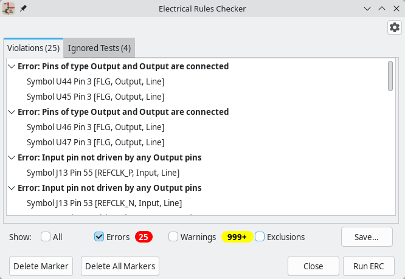

<figcaption>图 A-1ERC 对话框。左侧按错误类型分组列出违规对象；底部可筛选错误、警告和排除项，或重新运行检查。</figcaption>
</figure>

<figure class="illu illu-photo screenshot">

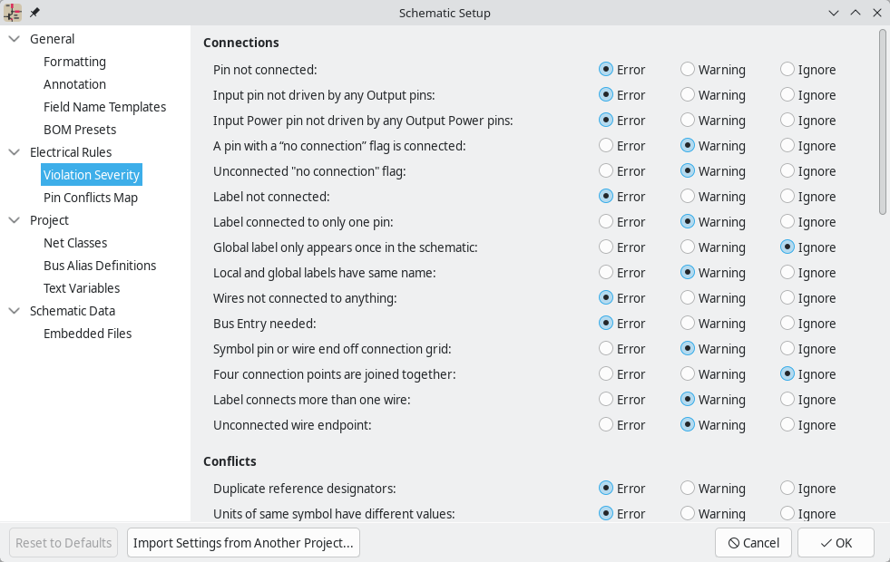

<figcaption>图 A-2Schematic Setup 的 Violation Severity 页。每类 ERC 检查可单独设为 Error、Warning 或 Ignore。</figcaption>
</figure>

<figure class="illu illu-photo screenshot">

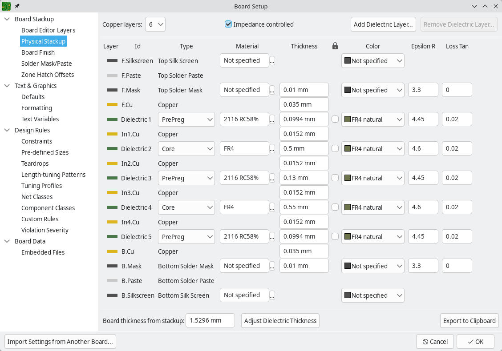

<figcaption>图 A-3Board Setup 的 Physical Stackup 页。层数、材料、厚度和铜厚在这里定义；板厚由叠层参数计算。</figcaption>
</figure>

<figure class="illu illu-photo screenshot">

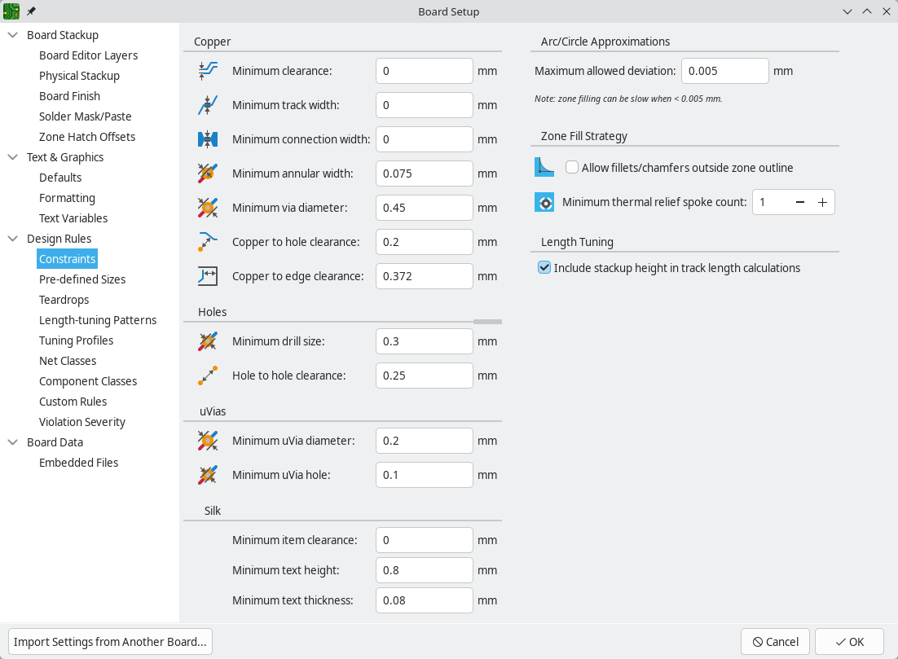

<figcaption>图 A-4Board Setup 的 Constraints 页。板级最小值在这里；网类中的线宽、过孔尺寸是默认值，不等同于 DRC 下限。</figcaption>
</figure>

<figure class="illu illu-photo screenshot">

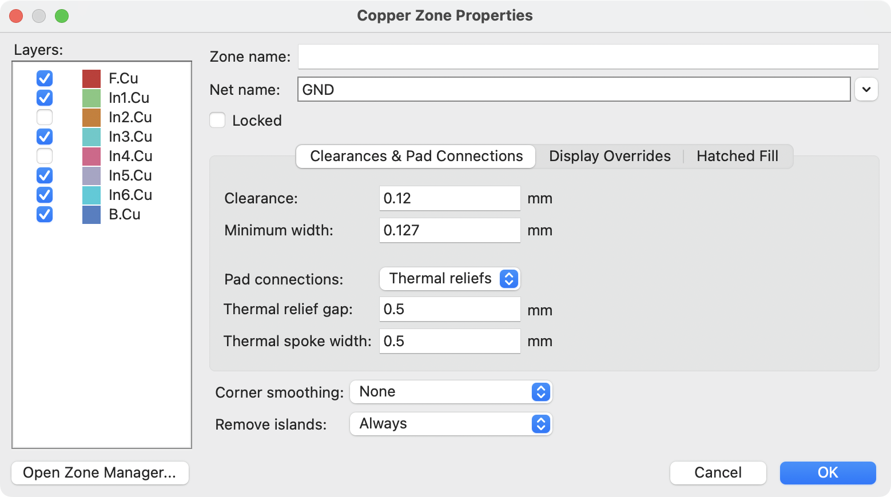

<figcaption>图 A-5Copper Zone Properties。网络、间距、焊盘连接方式、热焊盘参数和孤岛移除都在这里设置。</figcaption>
</figure>

<figure class="illu illu-photo screenshot">

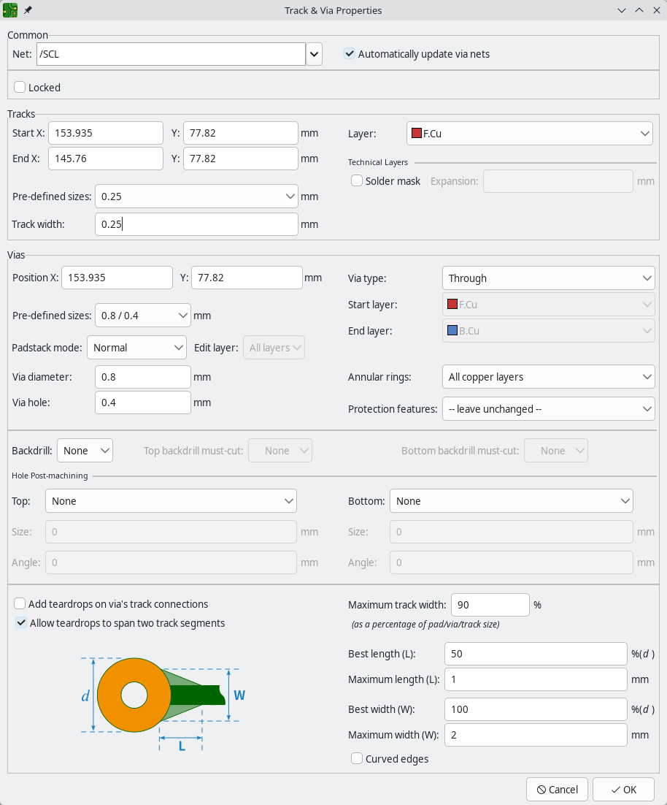

<figcaption>图 A-6Track &amp; Via Properties。选中走线或过孔后按 E 打开；可改网络（Net）、线宽、过孔尺寸和所在层。</figcaption>
</figure>

<figure class="illu illu-photo screenshot">

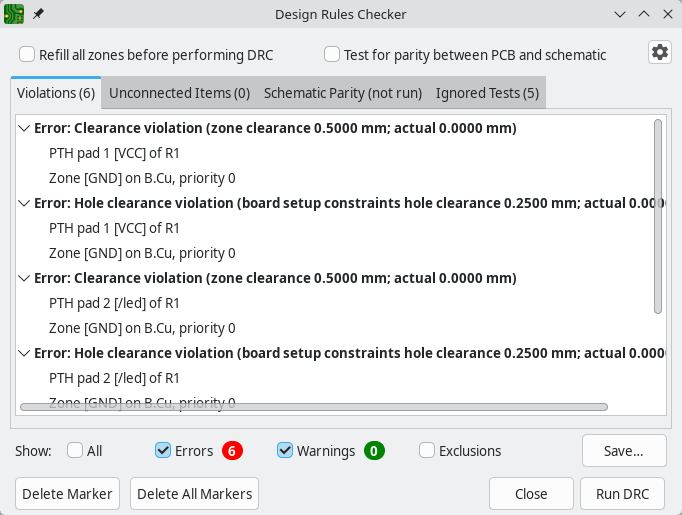

<figcaption>图 A-7DRC 的 Violations 页。每条记录给出规则、对象、实测值与要求值；底部可勾选 Exclusions、保存报告或重新运行；排除单条违规要用右键菜单。</figcaption>
</figure>

<figure class="illu illu-photo screenshot">

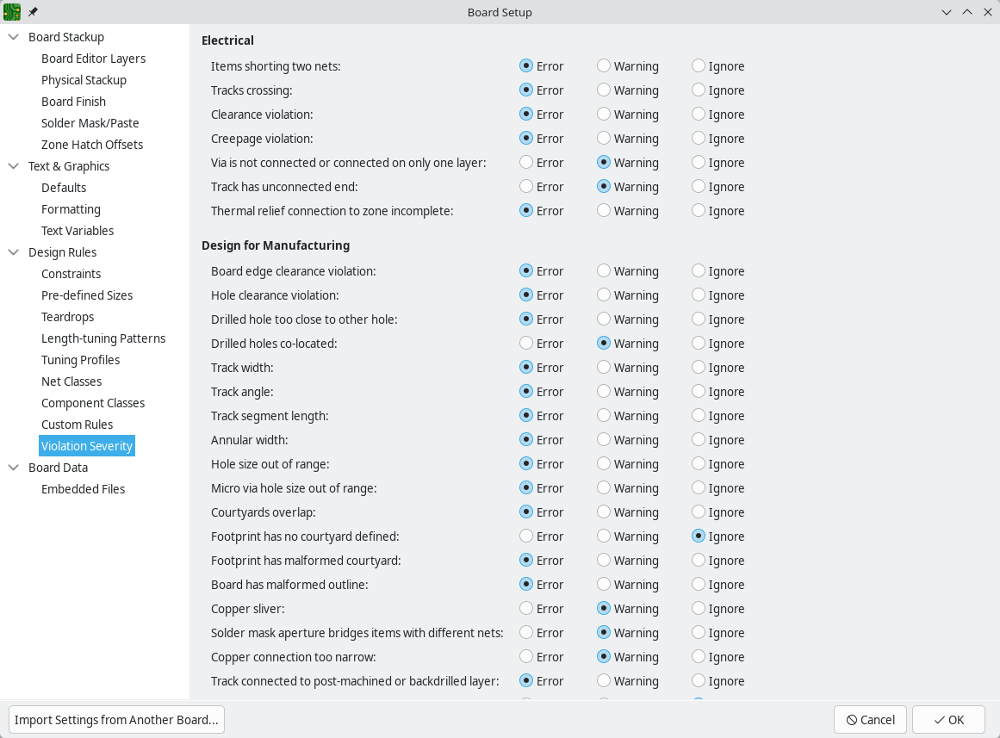

<figcaption>图 A-8Board Setup 的 Violation Severity 页。每类 DRC 违规可单独设为 Error、Warning 或 Ignore，决定是否阻塞发板。</figcaption>
</figure>

<figure class="illu illu-photo screenshot">

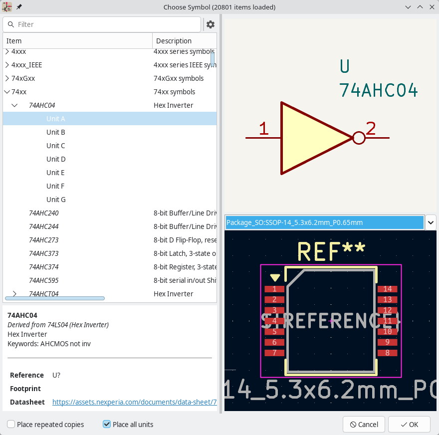

<figcaption>图 A-9Choose Symbol 对话框。可按库、名称和描述筛选；右侧预览符号与封装，选中后点 OK 放入原理图。</figcaption>
</figure>

<figure class="illu illu-photo screenshot">

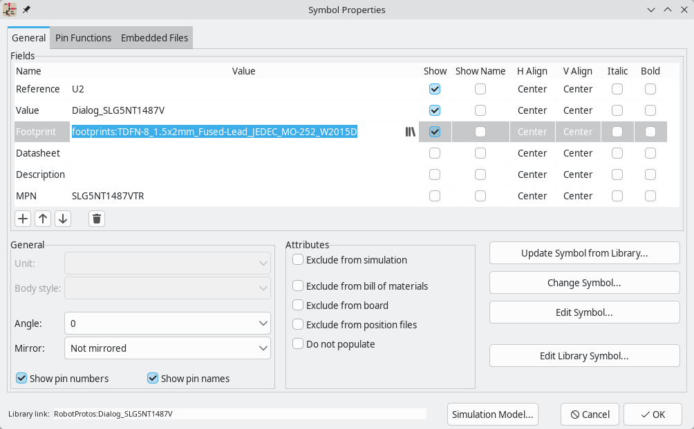

<figcaption>图 A-10Symbol Properties 的 Footprint 字段。符号与封装的对应关系在这里指定；字段值是可解析的封装库链接。</figcaption>
</figure>

<figure class="illu illu-photo screenshot">

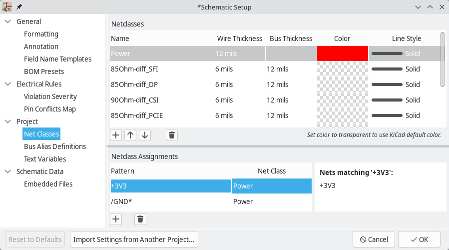

<figcaption>图 A-11Schematic Setup → Net Classes。可在原理图侧定义网类、成员和原理图导线显示粗细（Wire Thickness）；同一工程的 PCB 侧也能看到这组网类。</figcaption>
</figure>

<figure class="illu illu-photo screenshot">

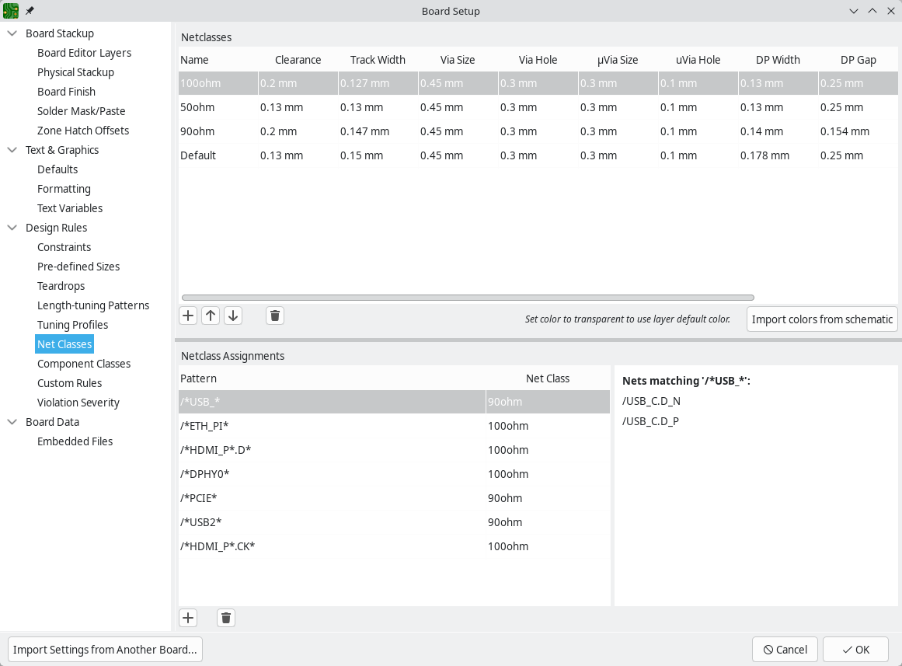

<figcaption>图 A-12Board Setup → Net Classes。线宽、间距、过孔尺寸和差分对参数按网类设置；线宽与过孔尺寸是布线优选值，板级最小值仍是硬下限。</figcaption>
</figure>

<figure class="illu illu-photo screenshot">

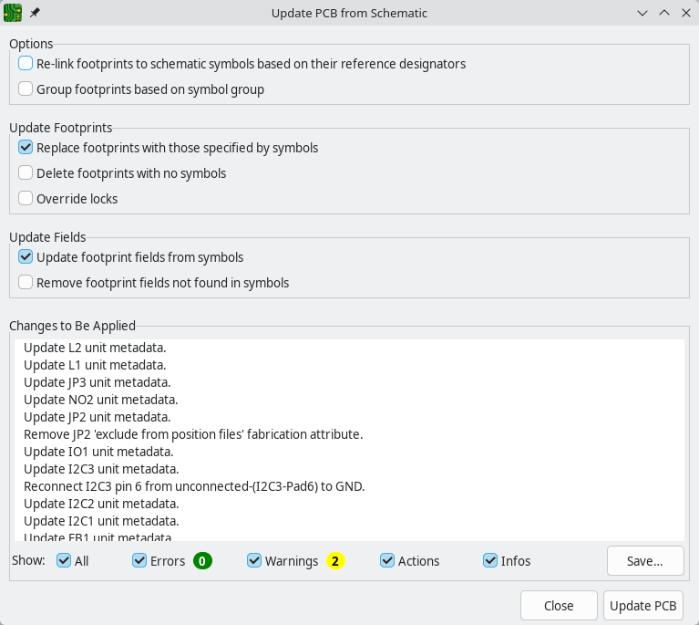

<figcaption>图 A-13Update PCB from Schematic。先看 Changes to Be Applied 列表，再点 Update PCB；封装、网络和位号改动都走这条同步链。</figcaption>
</figure>

<figure class="illu illu-photo screenshot">

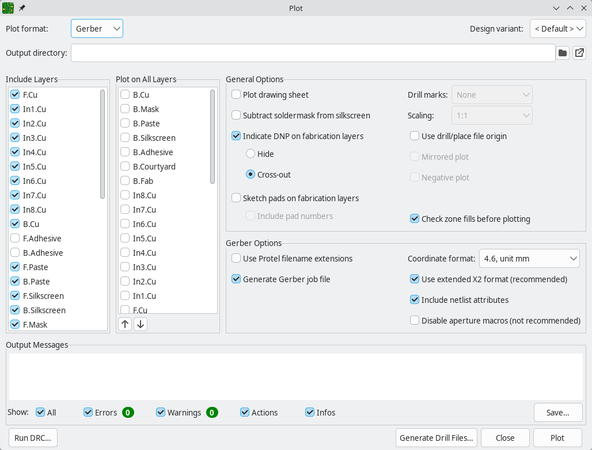

<figcaption>图 A-14Plot 对话框。选择 Gerber 格式、输出目录、层和选项；它是制造文件输出的 GUI 入口之一。</figcaption>
</figure>

<figure class="illu illu-photo screenshot">

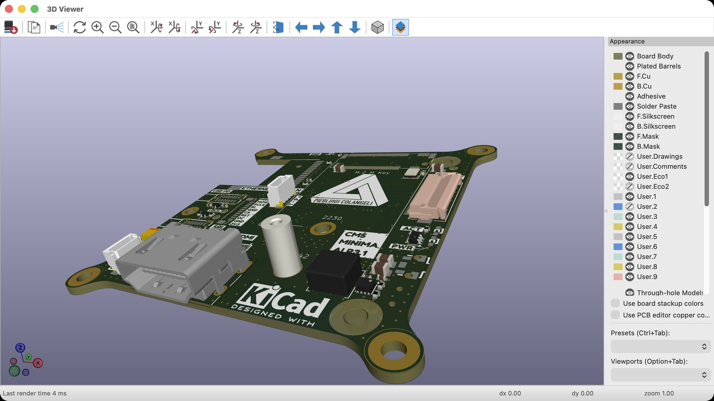

<figcaption>图 A-153D Viewer。用于检查板框、器件高度、丝印和连接器方向；它不能替代 DRC、DFM 或电气走查。</figcaption>
</figure>

<figure class="illu illu-photo screenshot">

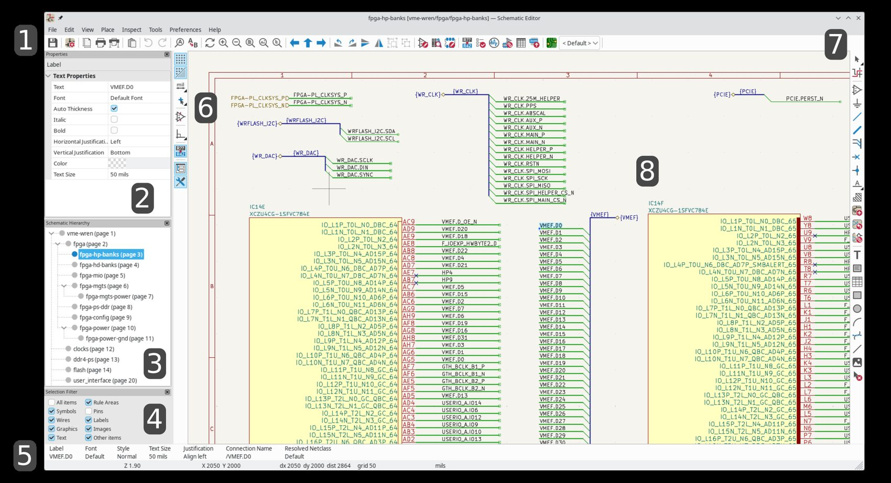

<figcaption>图 A-16Schematic Editor 总览。图中数字是官方文档的标注编号；常用区域是工具栏、绘图区、属性面板和底部状态栏。</figcaption>
</figure>

<figure class="illu illu-photo screenshot">

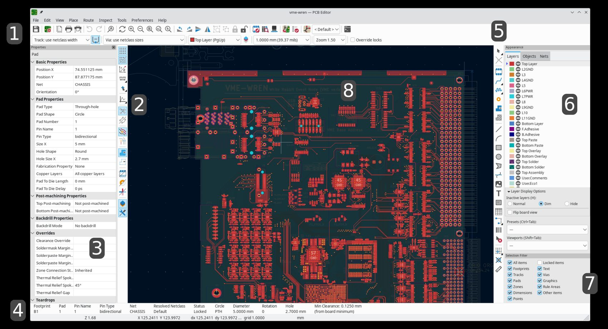

<figcaption>图 A-17PCB Editor 总览。官方文档用数字标出主要区域；这些数字是官方标注，不是本书的操作步骤编号。</figcaption>
</figure>

<figure class="illu illu-photo screenshot">

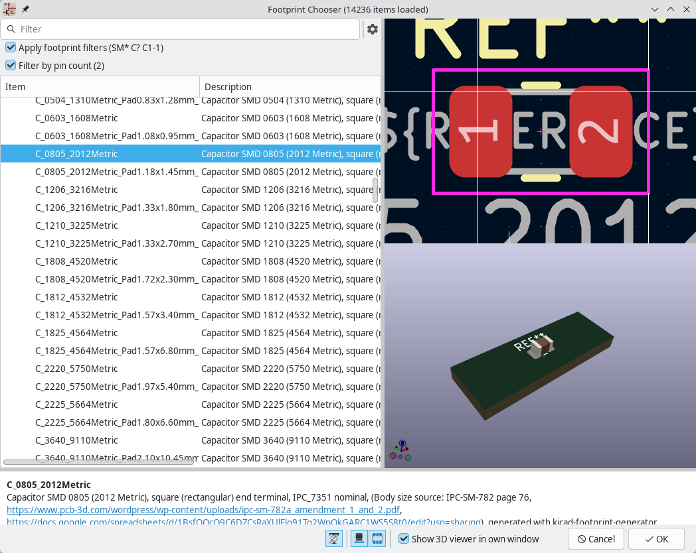

<figcaption>图 A-18Footprint Chooser。可按封装库、名称、引脚数和筛选条件查找封装；右侧预览焊盘与 3D 模型。</figcaption>
</figure>

<figure class="illu illu-photo screenshot">

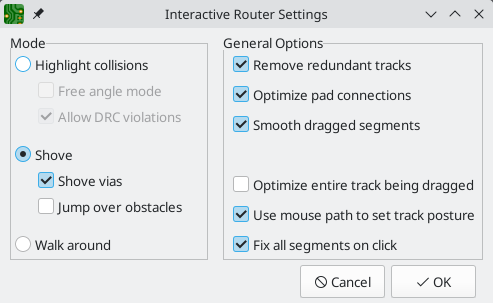

<figcaption>图 A-19Interactive Router Settings。布线模式、走线角度、过孔和推挤选项在这里设置；不同模式会改变走线时对既有铜皮的处理方式。</figcaption>
</figure>
